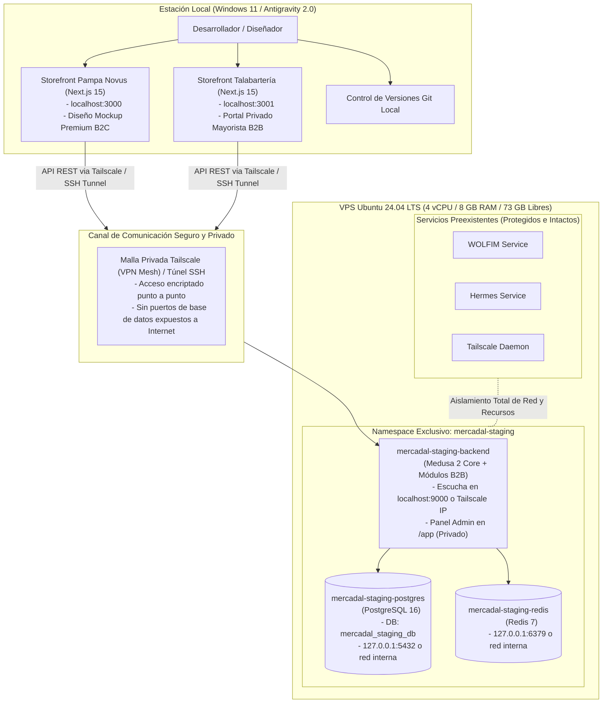

# Arquitectura del Sistema — Mercadal Digital 360

## 1. Visión y Topología General (Modelo Híbrido Local / VPS Staging)

Mercadal Digital 360 implementa una arquitectura desacoplada (*Headless Commerce*) distribuida entre la estación de trabajo local y un entorno de Staging aislado en el VPS Ubuntu existente:



---

## 2. Consolidación de Starters Oficiales (`b2b-starter` vs `dtc-starter`)

### 2.1. Problema de la Combinación a Ciegas
Ambos repositorios oficiales (`medusajs/dtc-starter` y `medusajs/b2b-starter`) contienen un backend completo en sus carpetas `apps/backend`. Levantar dos instancias separadas generaría:
- Dos bases de datos separadas o colisión destructiva de migraciones.
- Imposibilidad de compartir un inventario digital único en tiempo real sin una sincronización frágil entre servidores.
- Duplicación de consumo de memoria y complejidad operativa.

### 2.2. Definición Concreta del Backend Base y Módulos a Reutilizar
Para evitar conflictos de esquemas, dependencias y migraciones:

1. **Backend Base**: Se toma como base una aplicación limpia y desacoplada de Medusa 2 (`apps/backend`), inicializada directamente con `@medusajs/medusa` v2 sobre **Node 24 LTS / 22 LTS**.
2. **Módulos B2B Reutilizados del B2B Starter**:
   - `company`: Define la entidad corporativa `Company`, roles de empleados (`admin`, `buyer`), estado de aprobación comercial (`pending_approval`, `approved`, `rejected`), y vinculación a listas de precios.
   - `quote`: Define la entidad `Quote` (RFQ), ítems presupuestados, estados de negociación (`draft`, `pending_merchant`, `pending_customer`, `accepted`, `rejected`), y conversión a carrito/orden.
   - `approval`: Define reglas de límites de gasto (`spending_limit`), aprobación interna dentro de la empresa y retención de carritos (`pending_company_approval`).
3. **Mecanismo para Evitar Conflictos entre Módulos, Migraciones y Dependencias**:
   - Cada módulo B2B se aloja como un módulo local autocontenido en `apps/backend/src/modules/<modulo>` usando `createModule` de `@medusajs/framework/utils`.
   - Las relaciones con las entidades nativas (`Customer`, `Cart`, `Order`) se declaran mediante **Module Links** (`defineLink`), sin alterar los modelos core ni mutar tablas del núcleo.
   - Las migraciones de cada módulo residen en su propio subdirectorio y se aplican mediante `npx medusa db:migrate`, garantizando orden y trazabilidad.
   - Las dependencias se unifican en el `package.json` raíz del monorepo (Turborepo), fijando versiones estrictas para evitar colisiones de *peer dependencies*.

---

## 3. Seguridad y Aislamiento Multicapa (Más allá de las Publishable API Keys)

Las Publishable API Keys (PAK) son públicas en el navegador del cliente; por tanto, **NO se consideran una barrera de seguridad suficiente por sí solas**. El sistema implementa una arquitectura de seguridad en profundidad con **cinco capas de protección**:

```
[Cliente HTTP / Storefront Local]
       │
       ▼ (Túnel Privado SSH / Tailscale)
       │
[Capa 1: Routing & Contexto de Canal]
   └─ Valida `x-publishable-api-key` y fija `sales_channel_id` (sc_b2c o sc_b2b).
       │
       ▼
[Capa 2: Autenticación de Sesión / JWT]
   └─ Valida firma criptográfica del token de sesión (Bearer JWT). Determina el actor.
       │
       ▼
[Capa 3: Guards de Autorización en Endpoints (RBAC / Company Guard)]
   └─ Endpoints protegidos (/store/companies, /store/quotes, /store/approvals):
      Exigen que el cliente autenticado pertenezca a una `Company` con estado `approved`.
      Si no cumple: responde inmediatamente 401 Unauthorized o 403 Forbidden.
       │
       ▼
[Capa 4: Scoping Mandatorio de Consultas en Base de Datos]
   └─ Endpoints de historial (/store/customers/me/orders):
      Inyectan filtro forzoso `WHERE sales_channel_id = :context_channel_id`.
      Un usuario con el mismo email en ambas marcas jamás ve órdenes de la otra marca.
   └─ Endpoints de cotizaciones: inyectan `WHERE company_id = :customer_company_id`.
       │
       ▼
[Capa 5: Recálculo Server-Side de Precios y Reglas de Descuento]
   └─ El cliente no puede inyectar precios en el payload. Medusa 2 recalcula el precio
      de cada variante evaluando las reglas del `PriceList` asociadas al canal y al
      grupo comercial del cliente en PostgreSQL.
```

### Seguridad de Red y Cero Exposición Pública
1. **PostgreSQL**: Vinculado exclusivamente a `127.0.0.1` o a la red interna de Docker (`mercadal_staging_net`). Prohibido enlazar a `0.0.0.0`.
2. **Redis**: Vinculado exclusivamente a `127.0.0.1` o a la red interna de Docker.
3. **Panel Administrativo (`/app`)**: Accesible exclusivamente a través de la red privada **Tailscale** o mediante túnel SSH hacia `localhost:9000`. Ningún puerto administrativo queda expuesto a Internet público.

---

## 4. Inventario Digital Centralizado y Flujo Transaccional

### 4.1. Workflows Específicos de Medusa 2
Las reservas y ajustes de stock no se delegan a lógica ad-hoc, sino a los flujos oficiales de Medusa 2:

1. **Reserva durante Checkout**:
   - **`completeCartWorkflow`**: Al finalizar el checkout, ejecuta el paso **`reserveInventoryStep`**.
   - Consulta el inventario disponible en la ubicación `loc_digital_warehouse` (vinculada al canal correspondiente).
   - Si `available_quantity >= requested_quantity`, crea un registro en **`ReservationItem`** bloqueando la cantidad.
   - Si no hay disponibilidad suficiente, el paso falla y la transacción de checkout se revierte de forma atómica.
2. **Deducción de Inventario al Cumplir la Orden**:
   - **`createOrderFulfillmentWorkflow`**: Al despachar la orden, descuenta definitivamente los ítems de `InventoryLevel` y elimina la reserva asociada de `ReservationItem`.
3. **Restitución ante Cancelaciones**:
   - **`cancelOrderWorkflow`**: Si la orden se cancela antes del despacho, invoca **`deleteReservationsStep`**, liberando inmediatamente la reserva y restituyendo la disponibilidad de stock para ambos canales. Si ya había sido descontado físicamente, ejecuta **`adjustInventoryLevelsStep`**.
4. **Restitución ante Devoluciones**:
   - **`createReturnWorkflow`** y **`receiveReturnWorkflow`**: Al recibir el producto devuelto en el almacén, ejecutan **`adjustInventoryLevelsStep`**, reintegrando las unidades al balance disponible.

### 4.2. Tratamiento de la Prevención de Sobreventa
La prevención de sobreventas se define como un **objetivo de diseño arquitectónico**, cuyo cumplimiento se somete a validación empírica mediante pruebas de estrés concurrente (ver sección 2 de `implementation-plan.md`).

---

## 5. Aislamiento y Protección del VPS (WOLFIM, Hermes, Tailscale)

### 5.1. Reglas de Inviolabilidad del VPS
1. **Cero Modificación del Daemon**: No se reinstala ni reinicia el servicio Docker (`systemctl restart docker` PROHIBIDO).
2. **Cero Interferencia de Contenedores**: Ningún comando afectará contenedores ajenos al proyecto (`docker stop $(docker ps -q)` o `docker system prune` están TERMINANTEMENTE PROHIBIDOS).
3. **Namespace de Proyecto Exclusivo**: Todas las operaciones se orquestan con el flag de proyecto:
   ```bash
   docker compose -p mercadal-staging -f docker-compose.staging.yml <comando>
   ```
4. **Ciclo de Vida Autónomo**: Los contenedores de Mercadal Staging pueden levantarse (`up -d`) y destruirse (`down`) sin afectar en absoluto la operación continua de WOLFIM, Hermes o Tailscale.

### 5.2. Presupuesto y Límites de Recursos para Staging
Se configuran límites de recursos estrictos en `docker-compose.staging.yml`:

```yaml
version: '3.8'

services:
  mercadal-staging-postgres:
    image: postgres:16-alpine
    container_name: mercadal_staging_postgres
    restart: unless-stopped
    environment:
      POSTGRES_DB: mercadal_staging_db
      POSTGRES_USER: ${POSTGRES_STAGING_USER}
      POSTGRES_PASSWORD: ${POSTGRES_STAGING_PASSWORD}
    volumes:
      - mercadal_staging_pgdata:/var/lib/postgresql/data
    networks:
      - mercadal_staging_net
    deploy:
      resources:
        limits:
          cpus: '0.50'
          memory: 300M

  mercadal-staging-redis:
    image: redis:7-alpine
    container_name: mercadal_staging_redis
    restart: unless-stopped
    command: redis-server --appendonly yes --requirepass ${REDIS_STAGING_PASSWORD}
    volumes:
      - mercadal_staging_redisdata:/data
    networks:
      - mercadal_staging_net
    deploy:
      resources:
        limits:
          cpus: '0.25'
          memory: 100M

  mercadal-staging-backend:
    image: mercadal-backend:staging
    container_name: mercadal_staging_backend
    restart: unless-stopped
    ports:
      - "127.0.0.1:9000:9000"  # Exclusivo localhost / Tailscale (NO 0.0.0.0)
    depends_on:
      - mercadal-staging-postgres
      - mercadal-staging-redis
    networks:
      - mercadal_staging_net
    deploy:
      resources:
        limits:
          cpus: '1.0'
          memory: 500M
    oom_score_adj: 500  # Prioridad para ser sacrificado antes de tocar WOLFIM/Hermes en caso de OOM extremo

networks:
  mercadal_staging_net:
    name: mercadal_staging_net
    driver: bridge

volumes:
  mercadal_staging_pgdata:
    name: mercadal_staging_pgdata
  mercadal_staging_redisdata:
    name: mercadal_staging_redisdata
```

---

## 6. Separación Estricta entre Staging y Futura Producción

Para evitar cualquier mezcla accidental en el VPS:

| Parámetro | Entorno Staging | Entorno Producción (Futuro) |
|---|---|---|
| **Project Name Docker** | `mercadal-staging` | `mercadal-prod` |
| **Prefijo Contenedores** | `mercadal_staging_*` | `mercadal_prod_*` |
| **Red Docker** | `mercadal_staging_net` | `mercadal_prod_net` |
| **Volúmenes Nombrados** | `mercadal_staging_pgdata`, `...redisdata` | `mercadal_prod_pgdata`, `...redisdata` |
| **Base de Datos** | `mercadal_staging_db` | `mercadal_prod_db` |
| **Archivo Compose** | `docker-compose.staging.yml` | `docker-compose.prod.yml` |
| **Archivo de Variables** | `.env.staging` | `.env.production` |
| **Puerto Backend Host** | `127.0.0.1:9000` (vía Tailscale) | `127.0.0.1:9001` (vía Reverse Proxy SSL) |

---

## 7. Estado de Integraciones Argentinas (Pendientes de Validación)

Todas las integraciones externas se mantienen como **PENDIENTES DE VALIDACIÓN TÉCNICA**. Se ensayarán en Spikes técnicos de laboratorio en el backend de staging antes de certificar código para producción:

| Integración | Clasificación | Plan de Validación (Spike Técnico en Staging) |
|---|---|---|
| **Mercado Pago Argentina** | *Pendiente de Validación* | Probar en sandbox de staging con `@nicogorga/medusa-payment-mercadopago` o módulo custom; validar Checkout Pro, Payment Bricks y webhooks asíncronos. |
| **Mercado Libre** | *Pendiente de Validación* | Probar conector custom sobre API de Meli en staging; sincronización de stock y órdenes. |
| **Transportistas (Andreani / Correo Arg.)** | *Pendiente de Validación* | Implementar `IFulfillmentProvider` en staging y validar cálculo dinámico de flete por código postal. |
| **Facturación ARCA (ex-AFIP)** | *Pendiente de Validación* | Probar emisión de Factura A y B con CAE contra el servidor de Homologación de AFIP mediante `afip.js`. |
