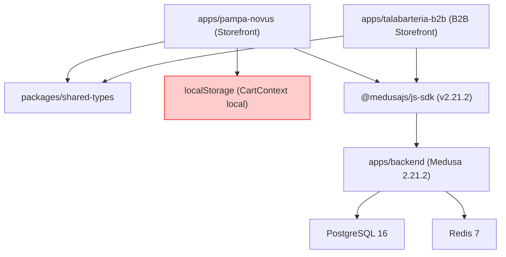
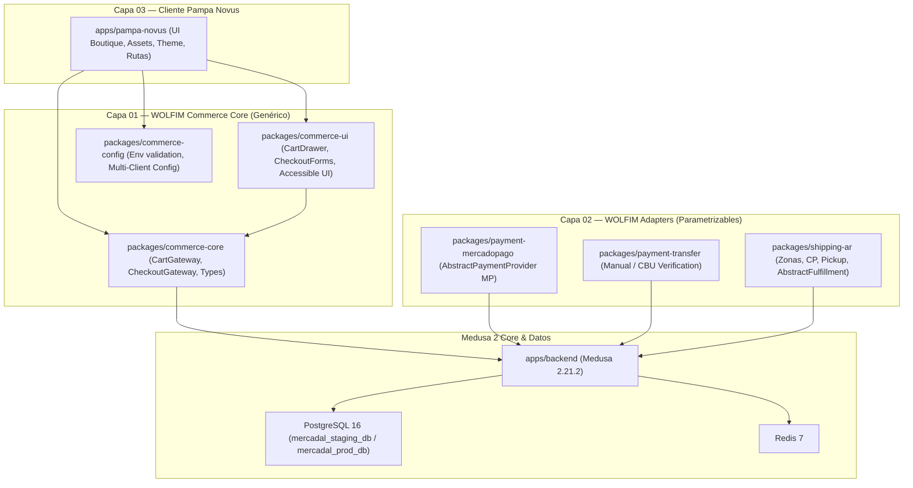

# AUDIT-G0 — Auditoría Técnica y Línea Base de Ejecución
**WOLFIM Commerce Core — Caso de Uso: Pampa Novus / Mercadal Digital 360**  
**Fecha:** 23/10/2026 · **Gate:** G0 (Solo Lectura / Inspección sin Modificaciones)  
**Estado General:** AUDITADA · VERIFICADA CON CÓDIGO FUENTE  

---

## 1. Estado del Repositorio y Git

- **Rama Base:** `main`
- **Último Commit:** `e5e6943` (`feat(pampa-novus): refine editorial luxury hero layout, scrim ease and typography`)
- **Estado del Working Tree:** Limpio (`clean`), sin cambios pendientes ni archivos sin trackear.
- **Sincronización Remota:** Sincronizado con `origin/main` en GitHub (`Ziramog/ecommerce.git`).
- **Entorno de Ejecución:** Node.js 22 LTS compatible (`packageManager: npm@10.9.9`, Turborepo `v2.4.0`).
- **Build Status Storefront:** Exitoso (`next build` compilado en 3.3s, 15 rutas estáticas y dinámicas validadas sin errores de tipos).
- **Suites Automatizadas Existentes:** 7/7 tests pasando (`@mercadal/pampa-novus test` con utilitarios, catálogo y aislamiento mayorista B2B).

---

## 2. Matriz de Verificación: Reporte vs Realidad del Código (`verified / partial / not verified`)

| Componente / Área | Reportado | Verificación en Código | Estado | Evidencias Técnicas |
|---|---|---|:---:|---|
| **Home Pampa Novus** | 100% | 100% | **VERIFIED** | [`Hero.tsx`](file:///c:/Projects/mercadal-digital360/apps/pampa-novus/src/components/home/Hero.tsx), [`HeroMediaBackground.tsx`](file:///c:/Projects/mercadal-digital360/apps/pampa-novus/src/components/home/HeroMediaBackground.tsx), [`CategoriesGrid.tsx`](file:///c:/Projects/mercadal-digital360/apps/pampa-novus/src/components/home/CategoriesGrid.tsx), [`FeaturedProducts.tsx`](file:///c:/Projects/mercadal-digital360/apps/pampa-novus/src/components/home/FeaturedProducts.tsx), [`BrandStory.tsx`](file:///c:/Projects/mercadal-digital360/apps/pampa-novus/src/components/home/BrandStory.tsx), [`Footer.tsx`](file:///c:/Projects/mercadal-digital360/apps/pampa-novus/src/components/home/Footer.tsx). Reproduce fielmente las láminas aprobadas. |
| **Catálogo B2C (`/catalogo`)** | 95% | 95% | **VERIFIED** | [`src/app/catalogo/page.tsx`](file:///c:/Projects/mercadal-digital360/apps/pampa-novus/src/app/catalogo/page.tsx). Grilla responsive, facetas de categoría, ordenamiento por precio y paginación reactiva. |
| **Ficha Producto (`/productos/[handle]`)** | 95% | 95% | **VERIFIED** | [`src/app/productos/[handle]/page.tsx`](file:///c:/Projects/mercadal-digital360/apps/pampa-novus/src/app/productos/[handle]/page.tsx). Galería fotográfica de alta resolución, cálculo de cuotas ARS, selector de variantes, indicador de stock y botón de compra. |
| **Carrito (`/carrito` & drawer)** | 60% | 50% | **PARTIAL** | [`src/context/CartContext.tsx`](file:///c:/Projects/mercadal-digital360/apps/pampa-novus/src/context/CartContext.tsx). El carrito reside **exclusivamente en `localStorage`** (`pampa_novus_cart_v1`). NO invoca `medusa.store.cart.create` ni `addLineItem`. Precios y totales calculados en el cliente. |
| **Checkout (`/checkout`)** | 0% | 0% | **VERIFIED (Inexistente)** | No existe directorio `src/app/checkout` ni rutas de proceso de compra, direcciones ni selección de medios de pago. |
| **Medusa Backend** | 80% | 85% | **VERIFIED** | Medusa versión `2.21.2` (`@medusajs/medusa`, `@medusajs/framework`). PostgreSQL 16 y Redis 7 configurados en [`medusa-config.ts`](file:///c:/Projects/mercadal-digital360/apps/backend/medusa-config.ts). |
| **Sales Channels & Keys** | 85% | 90% | **VERIFIED** | [`seed-staging.ts`](file:///c:/Projects/mercadal-digital360/apps/backend/src/scripts/seed-staging.ts). Canales creados: `sc_pampa_novus_b2c` y `sc_talabarteria_b2b`. Publishable keys independientes. Región ARS (`reg_...`) con país `ar`. |
| **Inventario Compartido B2B/B2C** | 85% PoC | 80% | **VERIFIED** | `loc_digital_warehouse` vinculado a ambos canales. 10 SKUs con niveles de inventario digital determinísticos. Sin embargo, no hay prueba E2E de `completeCartWorkflow` concurrente entre los dos storefronts en vivo. |
| **Pagos Mercado Pago** | 0% | 0% | **VERIFIED (Inexistente)** | No hay provider en [`medusa-config.ts`](file:///c:/Projects/mercadal-digital360/apps/backend/medusa-config.ts). Spike técnico completado en [`SPIKE-01-MERCADO-PAGO.md`](file:///c:/Projects/mercadal-digital360/docs/spikes/SPIKE-01-MERCADO-PAGO.md) determinando incompatibilidad de plugins v1 y necesidad de `AbstractPaymentProvider`. |
| **Envíos (Argentina)** | 15% | 10% | **PARTIAL** | Región ARS y perfil de envío base existen en backend. No hay provider custom de cálculo por código postal ni opción de retiro en tienda conectada al storefront. Spike en [`SPIKE-02-LOGISTICA-ENVIOS.md`](file:///c:/Projects/mercadal-digital360/docs/spikes/SPIKE-02-LOGISTICA-ENVIOS.md). |
| **Cuentas de Clientes B2C** | 20% | 10% | **PARTIAL** | No hay rutas `/login`, `/registro` ni `/cuenta` en Pampa Novus. El SDK Medusa permite autenticación, pero el storefront no la expone. |
| **Páginas Legales e Institucionales** | 10% | 0% | **NOT VERIFIED** | Rutas `/nuestra-historia`, `/contacto`, `/terminos-y-condiciones` y Botón de Arrepentimiento no existen en `src/app/` (arrojan 404). |
| **Catálogo de Producción** | 25% | 20% | **PARTIAL** | Están los 10 productos de prueba de la PoC con datos ficticios/fotos stock. Falta la tabla oficial de 15 SKUs de lanzamiento de Mercadal. |
| **Resiliencia de Storefront** | N/A | 100% | **VERIFIED (Hallazgo crítico)** | [`catalog.ts`](file:///c:/Projects/mercadal-digital360/apps/pampa-novus/src/lib/catalog.ts) tiene un fallback estático (`STATIC_B2C_FALLBACK_PRODUCTS`). Si Medusa está apagado, la web sigue funcionando y mostrando productos mockeados. **Riesgo:** Si no se desactiva en producción, un usuario podría intentar comprar datos simulados. |

---

## 3. Diagrama de Dependencias Reales vs Arquitectura Objetivo

### Estado Real Actual (Acoplamiento en Storefront):

*Observación:* No existe ninguna capa de abstracción genérica de WOLFIM. Toda la lógica de carrito está acoplada directamente a React Hooks y `localStorage` dentro de `apps/pampa-novus`.

### Arquitectura Objetivo (WOLFIM Commerce Core por Capas):

**Regla de Oro de Dependencias:**  
`apps/pampa-novus -> packages/commerce-* -> @medusajs/js-sdk`.  
**Queda terminantemente prohibido** que `packages/*` importe activos, imágenes, textos o rutas desde `apps/pampa-novus`.

---

## 4. Inventario de Activos de Pampa Novus vs Código Reutilizable WOLFIM

### A. Activos Específicos de Pampa Novus (Capa 03 — Intocables)
- Identidad gráfica: Monograma, sello, isologo, logotipo apilado y horizontal en `apps/pampa-novus/public/brand/`.
- Media cinematográfico: Videos `hero_video.mp4`, `hero_video2.mp4` y foto master en `public/images/home/`.
- Tipografía y tokens de diseño: Cormorant Garamond, DM Sans, paleta de colores institucional (`pn-espresso`, `pn-marron`, `pn-cognac`, `pn-arena`, `pn-crema`).
- Copys de marca: *"Raíces ecuestres. Estilo contemporáneo."*, *"Tradición que avanza"*.

### B. Código Reutilizable a Extraer / Construir (Capas 01 y 02 — WOLFIM Core)
- `CartGateway`: Fachada tipada para operar carritos de Medusa 2 (`create`, `addLine`, `updateLine`, `removeLine`, `getCart`, `completeCart`).
- `CheckoutUI`: Formularios de checkout accesibles, agnósticos de marca, con validación de DNI/CUIT, dirección argentina (provincia, localidad, CP) y selección de envío/pago.
- `MercadoPagoPaymentProvider`: Módulo para Medusa 2 basado en `AbstractPaymentProvider` con Checkout Pro / Bricks, cálculo de firma de webhook, validación server-to-server e idempotencia estricta.
- `ArgentinaShippingProvider`: Módulo de fulfillment para cálculo de tarifas planas por zona postal, validación de CP (4 dígitos o CPA) y retiro en punto de entrega.

---

## 5. Ranking de Riesgos Técnicos y Operativos

| # | Riesgo Identificado | Severidad | Probabilidad | Impacto | Estrategia de Mitigación en WOLFIM Core |
|---|---|:---:|:---:|:---:|---|
| **R1** | **Discrepancia y duplicidad de Webhooks en Mercado Pago** | **Crítica** | Media | Alto (Cobro duplicado o cobrado sin orden creada en Medusa). | Implementar tabla/almacén de idempotencia por `x-signature` y `payment_id`. Verificación servidor-servidor antes de autorizar. Nunca completar orden basándose en el redirect del navegador (`back_url`). |
| **R2** | **Sobrevendido de inventario en concurrencia (Stock = 1)** | **Alta** | Media | Alto (Venta de stock inexistente a dos clientes minoristas/mayoristas simultáneos). | Delegar la reserva atómica a Medusa 2 (`completeCartWorkflow`) que ejecuta lock a nivel base de datos sobre el `InventoryLevel`. Prueba de concurrencia obligatoria en G1. |
| **R3** | **Persistencia de Fallback Mock en Producción** | **Alta** | Alta | Alto (Usuarios comprando productos falsos con precios de prueba si cae el backend). | Deshabilitar el fallback estático mediante `NODE_ENV === 'production'`. En producción, si Medusa no responde, mostrar pantalla de servicio temporal o reintentos seguros. |
| **R4** | **Fuga de Secretos en Repositorio o Frontend** | **Crítica** | Baja | Crítico (Compromiso de cuenta de Mercado Pago o base de datos). | Claves públicas (`pk_...`, `NEXT_PUBLIC_...`) estrictamente limitadas. Tokens privados (`MP_ACCESS_TOKEN`, `JWT_SECRET`, DB passwords) inyectados exclusivamente por variables de entorno del servidor. |
| **R5** | **Bloqueo de Ventas por Forzar Creación de Cuenta** | **Media** | Alta | Pérdida de hasta el 70% de conversión B2C. | Implementar **Guest Checkout obligatorio en G1**. El cliente solo proporciona Email, Nombre, Teléfono y Dirección para comprar; registro de contraseña queda como paso opcional post-compra. |
| **R6** | **Incumplimiento Legal Normativo Argentino** | **Media** | Alta | Sanciones de Defensa del Consumidor / AFIP. | Incorporar Botón de Arrepentimiento mandatorio, Términos & Condiciones y Políticas de Devolución en Capa 03. |

---

## 6. Estimación de Esfuerzo por Gate (Horas y Rangos)

| Gate | Alcance Principal | Horas Estimadas (Rango) | Dependencias |
|---|---|:---:|---|
| **G0** | Auditoría de lectura, AUDIT-G0, ADR-001 de reutilización, mapa de dependencias y plan. | **4 – 6 h** *(Completada)* | Acceso a monorepo e información de contexto. |
| **G1** | CAPA 01: Creación de `packages/commerce-core`, sincronización de Cart Medusa 2, checkout invitado en 2 pasos, tests unitarios y de concurrencia. | **14 – 18 h** | Aprobación de G0. Acceso a Medusa Staging. |
| **G2** | CAPA 02: `packages/payment-mercadopago` (AbstractPaymentProvider, Checkout Pro, webhooks con firma e idempotencia), `packages/shipping-ar` (tarifas zonales y pickup), tests sandbox. | **16 – 22 h** | Aprobación de G1. Credenciales de Sandbox MP. |
| **G3** | CAPA 03: Adaptación temática boutique en Pampa Novus, páginas legales, botón de arrepentimiento, carga de los 15 SKUs reales de Mercadal, eliminación de fallbacks mock. | **12 – 16 h** | Aprobación de G2. Tabla oficial de 15 SKUs de Mercadal. |
| **G4** | Operaciones y Preproducción: Aislamiento Docker Compose (`-p mercadal-staging / mercadal-prod`), pruebas de carga mínimas, backup y restore ensayado, checklist GO-LIVE. | **8 – 12 h** | Aprobación de G3. Acceso a VPS Staging. |
| **G5** | Go-Live y Salida a Producción: Deploy controlado en VPS, vinculación de dominio, SSL Let's Encrypt, smoke tests de pago real, entrega y acta operativa. | **6 – 10 h** | Aprobación expresa de WOLFIM y titular de Mercadal. |
| **Total Estimado** | **Flujo E2E Completo hacia Producción** | **60 – 84 h** | |

---

## 7. Decisiones que Requieren Aprobación Antes de Avanzar a G1

1. **Estructura de Paquetes en Monorepo**: ¿Aprobamos crear `packages/commerce-core` y `packages/commerce-ui` dentro de los workspaces de Turborepo para encapsular toda la lógica transaccional de Medusa 2 sin ensuciar el storefront boutique?
2. **Guest Checkout como Prioridad**: ¿Confirmamos que en G1 el checkout será de compra como invitado (sin requerir contraseña) para maximizar la conversión inicial?
3. **Modalidad de Mercado Pago para G2**: ¿Aprobamos Checkout Pro (redirección oficial a Mercado Pago con tarjetas, dinero en cuenta y cuotas) como el flujo principal para minimizar fricción y evitar manejo de PCI-DSS en el storefront?
4. **Desactivación de Fallbacks en Producción**: ¿Aprobamos que en modo producción (`NODE_ENV === 'production'`) el storefront falle de forma limpia si Medusa no responde, eliminando el riesgo de vender productos mockeados?
