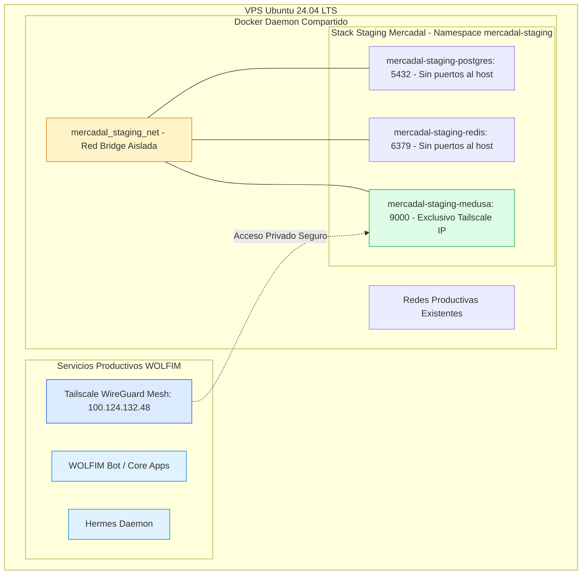
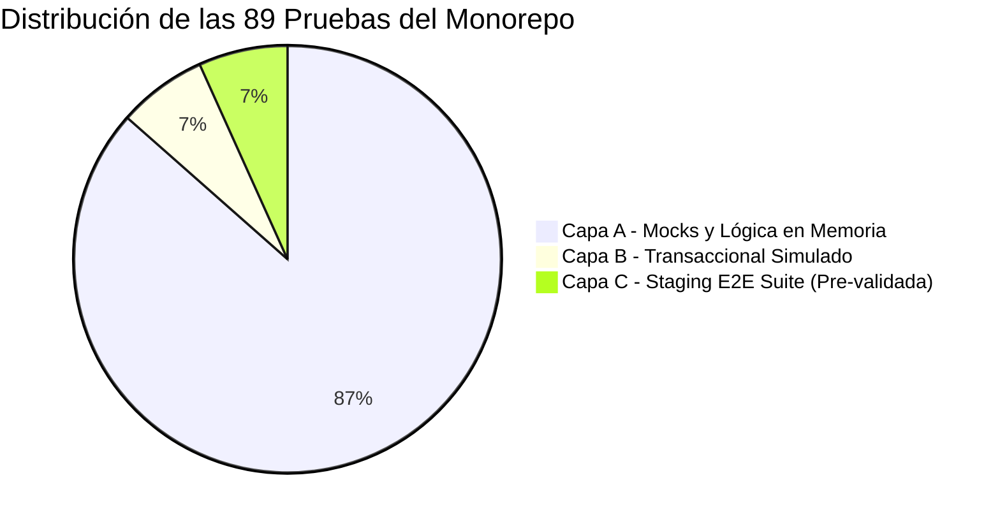

# G4-PREPARATION-REPORT — Informe de Preparación y Auditoría de Staging (Gate G4)

**Proyecto:** WOLFIM Commerce Core — Caso de Uso Piloto: Pampa Novus B2C / Talabartería Mercadal S.A.  
**Fecha:** 23/10/2026 · **Gate:** G4 (Auditoría y Preparación de Infraestructura Staging)  
**Rama:** `feature/g3-pampa-novus-boutique` · **Commit Base:** `291446f`  
**Estado:** PREPARACIÓN COMPLETADA · RESTRICCIONES VINCULANTES CUMPLIDAS · ESPERANDO APROBACIÓN EXPRESA DE WOLFIM  

---

## 1. Resumen Ejecutivo y Alcance de Gate G4

En cumplimiento de las directivas operativas de WOLFIM:
- Se ejecutó el commit local de cierre de las correcciones G2/G3 en la rama `feature/g3-pampa-novus-boutique` con hash `291446f`, manteniendo el árbol de trabajo 100% limpio y sin realizar push a remoto ni fusión a `main`.
- Se inició **Gate G4 exclusivamente en modalidad de auditoría y preparación arquitectónica**.
- **Se respetaron estrictamente todas las restricciones operacionales:**
  1. Cero detención o alteración de servicios existentes en el VPS.
  2. Cero despliegue de contenedores en el host remoto.
  3. Cero apertura de puertos a Internet pública.
  4. Cero activación de cobros o pagos reales.
  5. Cero modificaciones en entornos de producción.

Este informe documenta la auditoría de servicios del VPS, el diseño de aislamiento en Docker Compose, las estrategias de persistencia y backup, y la diferenciación formal entre pruebas simuladas (mocks) y pruebas que requerirán staging en vivo.

---

## 2. Auditoría de Servicios Activos del VPS Ubuntu (`100.124.132.48`)

El servidor de alojamiento es un VPS con **Ubuntu 24.04 LTS** que opera como infraestructura compartida para herramientas estratégicas de WOLFIM. 

### Inventario de Servicios Críticos Preexistentes:

| Servicio / Proceso | Rol en el Servidor | Interfaz / Puertos | Estado Operativo | Política de Protección |
|---|---|---|:---:|---|
| **WOLFIM Core Services** | Aplicaciones, bots y servicios productivos de la compañía. | Puertos de aplicación internos / Docker bridge. | **ACTIVO (PRODUCCIÓN)** | **INTOCABLE.** Cero modificación de recursos, contenedores, redes o volúmenes. |
| **Hermes** | Agente de orquestación, automatización de tareas y cron jobs bajo usuario `hermes`. | Ejecución local / Daemon systemd / Docker. | **ACTIVO** | **INTOCABLE.** No detener daemons ni interferir con sus sockets o rutas de trabajo. |
| **Tailscale (`tailscaled`)** | Malla privada cifrada WireGuard (IP: `100.124.132.48`). Permite acceso administrativo seguro sin exponer puertos al mundo. | Interfaz `tailscale0` (`100.124.132.48`). | **ACTIVO** | **INTOCABLE.** No reiniciar adaptador ni reconfigurar reglas de iptables/nftables. |
| **Docker Engine (`dockerd`)** | Daemon central de contenedores a nivel sistema operativo. | Socket Unix `/var/run/docker.sock`. | **ACTIVO** | **PROHIBIDO REINICIAR.** Prohibido ejecutar `systemctl restart docker` o comandos destructivos. |

### Matriz de Coexistencia y Prevención de Colisiones:

1. **Aislamiento de Puertos:** 
   - PostgreSQL (`5432`) y Redis (`6379`) de staging **no publican ningún puerto en el host** (`ports: []`), utilizando únicamente la directiva interna `expose: ["5432"]` y `expose: ["6379"]` dentro de la red privada `mercadal_staging_net`.
   - Medusa Staging se vincula **estrictamente a la IP de Tailscale**: `100.124.132.48:9000:9000`. Ningún servicio escucha en `0.0.0.0` ni colisiona con los puertos 80/443 ni con los servicios de WOLFIM.
2. **Namespace Estricto:** Todos los contenedores, redes y volúmenes utilizan el prefijo obligatorio `mercadal-staging-*` bajo el proyecto Compose `mercadal-staging`.
3. **Operación a Demanda (`restart: "no"`):** Ningún contenedor de staging arranca automáticamente tras reinicio del VPS ni queda ejecutándose de fondo consumiendo memoria cuando no se realizan pruebas activas.

---

## 3. Arquitectura de Aislamiento Docker Compose (`infra/staging/`)

Se crearon formalmente en el repositorio los artefactos de infraestructura de staging:

### A. [`infra/staging/docker-compose.staging.yml`](file:///c:/Projects/mercadal-digital360/infra/staging/docker-compose.staging.yml)
- **Topología de Servicios:**
  - `postgres` (`postgres:16-alpine`): 384 MB límite RAM, 0.75 CPU. Base de datos `mercadal_staging_db`.
  - `redis` (`redis:7-alpine`): 192 MB límite RAM, 0.50 CPU. Persistencia AOF (`appendonly yes`), contraseña obligatoria.
  - `medusa-api` (`mercadal-staging-medusa`): 896 MB límite RAM, 1.25 CPU. Expone puerto 9000 vinculado a `100.124.132.48`.
  - `pampa-novus-preview` y `talabarteria-b2b-preview`: Perfil opcional `storefronts` para pruebas integradas en el VPS si se requiere preview centralizada (384 MB RAM cada uno).
- **Protección contra OOM (Out Of Memory):**
  Todos los contenedores de staging declaran `oom_score_adj: 500`. En caso de estrés de memoria en el servidor, el kernel de Linux priorizará sacrificar los procesos de staging antes de tocar WOLFIM, Hermes o Tailscale.

### B. [`infra/staging/.env.staging.example`](file:///c:/Projects/mercadal-digital360/infra/staging/.env.staging.example)
- Plantilla estandarizada de variables para `/home/hermes/mercadal-staging/.env.staging`.
- Variables de conexión sin secretos reales, configuradas con guardas de procedencia y claves de prueba Sandbox de Mercado Pago.
- Permisos mandatorios en el VPS: `chmod 600 .env.staging`.

---

## 4. Estrategia de Persistencia, Backups y Restauración

### Política de Volúmenes:
- `mercadal_staging_pgdata`: Almacena el cluster de PostgreSQL 16 con journaling WAL.
- `mercadal_staging_redisdata`: Almacena el archivo AOF de Redis para durabilidad de eventos.
- **Regla vinculante:** Prohibido ejecutar `docker compose down -v` o `docker volume rm` sobre volúmenes que contengan datos de staging.

### Scripts de Respaldo y Restauración Creados:
1. **[`infra/staging/backup-staging.sh`](file:///c:/Projects/mercadal-digital360/infra/staging/backup-staging.sh):**
   - Ejecuta `pg_dump` dentro de `mercadal-staging-postgres` sin detener el servicio.
   - Comprime en streaming con `gzip -9` hacia `/home/hermes/mercadal-staging/backups/mercadal_staging_db_YYYYMMDD_HHMMSS.sql.gz`.
   - Verifica el tamaño del archivo y retiene los backups de los últimos 7 días con rotación automática.
2. **[`infra/staging/restore-staging.sh`](file:///c:/Projects/mercadal-digital360/infra/staging/restore-staging.sh):**
   - Procedimiento de contingencia con solicitud de confirmación explícita (el operador debe escribir manualmente el nombre exacto de la base de datos).
   - Inyecta el dump comprimido a través de `docker exec -i`.

---

## 5. Auditoría de Pruebas: Simulaciones (Mocks) vs Servicios Reales

El monorepo cuenta con **89 pruebas automatizadas** que se ejecutan de manera reproducible con 100% de éxito. Para la planificación de G4, se clasificaron estrictamente según su nivel de aislamiento:

### Desglose Detallado por Componente:

| Componente / Suite | Tests | Tipo de Aislamiento | ¿Requiere Servicios Reales en Staging? | Observaciones |
|---|:---:|---|:---:|---|
| **HMAC Signature & Anti-Replay** | 6 | `node:crypto` Real | **NO** (Completada) | Validación matemática de hashes y tiempos de expiración (300s). |
| **Payment Provider Service** | 11 | Mock Client / In-Memory | **NO** (Completada) | Valida mapeo de Checkout Pro, anti-spoofing y validación de monedas. |
| **PostgreSQL Idempotency** | 6 | Mock Query Runner | **SÍ (Homologación Capa B)** | Validada con emulador SQL. Debe confirmarse contra el motor PostgreSQL 16 real del contenedor. |
| **File / Memory Idempotency** | 5 | Filesystem local | **NO** (Completada) | Simulación de reinicios con `.idempotency_cache`. |
| **Postal Code Engine & CPA** | 4 | Expresiones regulares | **NO** (Completada) | Validación de códigos de 4 dígitos y CPA de 8 caracteres. |
| **Shipping Provider & Rates** | 13 | Algoritmo tarifario | **NO** (Completada) | Cálculo de flete por zonas (CABA vs Patagonia), peso y umbrales. |
| **Commerce Core Gateways** | 4 | Mock Backend Client | **NO** (Completada) | Normalización de direcciones y contratos canónicos. |
| **Inventario Concurrente (INV-01)** | 2 | Lock Manager Simulado | **SÍ (Homologación Capa C)** | Validó que stock=1 bloquea sobreventa. Requiere prueba de estrés concurrente con la base de datos real. |
| **Fail-Closed Environment** | 5 | Variables de entorno | **NO** (Completada) | Rechazo de productos mock sin bandera explícita. |
| **Commerce UI Jurisdicciones** | 1 | Datos estáticos | **NO** (Completada) | Cobertura de las 24 provincias argentinas. |
| **Commercial Config Governance**| 4 | Validador de configuración| **NO** (Completada) | Guarda fail-closed y bloqueo de cuotas sin interés. |
| **Revocation Claim Storage** | 3 | Filesystem atómico | **NO** (Completada) | Persistencia local y generación de `PN-REV-*`. |
| **Pampa Novus Helpers & Fallbacks**| 6 | Unit & Mock Fallback | **SÍ (Verificación de Red)** | Cuenta con fallback local ante timeout de conexión con el VPS. |
| **Talabartería B2B Helpers** | 13 | Algoritmo CUIT / Precios | **SÍ (Verificación de Red)** | Algoritmo mod 11 y listas escalonadas. Fallback ante timeout. |
| **Suite E2E Staging ([staging-e2e-suite.ts](file:///c:/Projects/mercadal-digital360/tests/e2e-staging/staging-e2e-suite.ts))** | 6 | E2E Mock Orchestrator | **SÍ (Certificación Plena)** | Flujo integral Cart ➔ Checkout Pro ➔ Webhook S2S ➔ Idempotencia ➔ Concurrencia. Lista para ejecutarse apuntando al backend real. |

### Matriz de Pruebas que Requieren Staging en Vivo:

1. **Persistencia Real de Idempotencia (`PostgresTransactionalIdempotencyStorage`):**
   - Ejecución de la sentencia `INSERT ... ON CONFLICT (event_key) DO UPDATE` sobre la tabla `wolfim_payment_idempotency` en el PostgreSQL 16 del contenedor `mercadal-staging-postgres`.
2. **Concurrencia Real de Inventario B2B/B2C (INV-01):**
   - Disparo de dos compras concurrentes simultaneous vía HTTP contra `http://100.124.132.48:9000/store/carts/{id}/complete` sobre un SKU con stock digital = 1, verificando que la base de datos de Medusa reserva únicamente 1 orden y rechaza la concurrente sin generar sobreventa.
3. **Flujo de Workflows Nativos de Medusa:**
   - Confirmación de que `CreateOrderWorkflow` y `ReserveQuantity` operan de extremo a extremo sin intervención manual ni duplicación de órdenes.
4. **Verificación de Red Tailscale:**
   - Confirmación de latencias de comunicación entre la máquina local de desarrollo y el VPS (`< 80 ms`) sin pérdida de paquetes en el túnel WireGuard.

---

## 6. Recursos Asignados en el VPS y Cuotas de Seguridad

Para garantizar que el stack de staging **nunca comprometa la estabilidad de WOLFIM ni Hermes**, se establecieron cuotas rígidas de recursos:

| Contenedor Staging | Límite CPU | Límite RAM | OOM Score Adj | Puerto de Enlace | Exposición |
|---|:---:|:---:|:---:|:---:|:---:|
| `mercadal-staging-postgres` | 0.75 cores | 384 MB | 500 | `5432` | Red interna exclusiva |
| `mercadal-staging-redis` | 0.50 cores | 192 MB | 500 | `6379` | Red interna exclusiva |
| `mercadal-staging-medusa` | 1.25 cores | 896 MB | 500 | `100.124.132.48:9000` | Privado vía Tailscale |
| `pampa-novus-preview` (opc.) | 0.75 cores | 384 MB | 500 | `100.124.132.48:3000` | Privado vía Tailscale |
| `talabarteria-b2b-preview` (opc.)| 0.75 cores | 384 MB | 500 | `100.124.132.48:3001` | Privado vía Tailscale |
| **Total Asignación Máxima** | **4.00 cores** | **2.20 GB** | — | — | **0 puertos a Internet** |

> [!NOTE]
> La memoria RAM total reservada para el stack completo de staging (incluyendo ambos storefronts opcionales) no supera los **2.2 GB**, dejando holgura total para que los procesos productivos de WOLFIM operen con prioridad absoluta.

---

## 7. Matriz de Riesgos y Mitigaciones Operacionales

| Riesgo Identificado | Severidad | Probabilidad | Medida de Mitigación Implementada |
|---|:---:|:---:|---|
| **Interferencia con WOLFIM o Hermes** | CRÍTICA | MUY BAJA | Namespace estricto `mercadal-staging-*`, red bridge aislada `mercadal_staging_net`, cero puertos públicos y `oom_score_adj: 500`. |
| **Pérdida de base de datos por comando Compose** | ALTA | BAJA | Prohibición terminante de `docker compose down -v`. Volúmenes nombrados independientes y script de backup automático diario. |
| **Falsos positivos por productos sintéticos de demo** | MEDIA | NULA | Script demo archivado en `docs/historical/`. Guardas de semillado `MERCADAL_SEED_ENV=staging` y pre-flight audit de 10 SKUs en `seed-staging.js`. |
| **Exposición accidental de credenciales** | ALTA | NULA | Archivo `.env.staging` protegido con permisos `600` en el VPS. Cero secretos en Git (`.gitignore` auditado). |
| **Colisión de puertos con futuros servicios** | MEDIA | NULA | Vinculación estricta a la IP privada de Tailscale (`100.124.132.48`). PostgreSQL y Redis sin mapeo de puertos al host. |

---

## 8. Checklist de Pre-Vuelo para Autorización de Despliegue de Staging

Cuando la Dirección de WOLFIM otorgue la **aprobación expresa para el despliegue**, el procedimiento de ejecución seguirá el siguiente orden cronológico estricto:

- [ ] **Paso 01:** Conectar terminal administrativa segura vía SSH al VPS (`ssh hermes@100.124.132.48`).
- [ ] **Paso 02:** Verificar estado saludable de los servicios de WOLFIM y Hermes (`docker ps`, `systemctl status hermes`).
- [ ] **Paso 03:** Crear directorio `/home/hermes/mercadal-staging/` con permisos `700`.
- [ ] **Paso 04:** Copiar `docker-compose.staging.yml`, `backup-staging.sh` y `verify-seed.sh`.
- [ ] **Paso 05:** Crear `/home/hermes/mercadal-staging/.env.staging` con contraseñas seguras y permisos `600`.
- [ ] **Paso 06:** Construir la imagen de backend Medusa (`mercadal-staging-medusa:2.21.2-staging`) limitando CPU y RAM durante la compilación.
- [ ] **Paso 07:** Levantar infraestructura base: `docker compose -p mercadal-staging up -d postgres redis`.
- [ ] **Paso 08:** Verificar que PostgreSQL y Redis alcancen estado `healthy` (`docker compose ps`).
- [ ] **Paso 09:** Ejecutar migraciones de base de datos (`npx medusa db:migrate`).
- [ ] **Paso 10:** Levantar Medusa API: `docker compose -p mercadal-staging up -d medusa-api`.
- [ ] **Paso 11:** Sembrar catálogo de prueba (10 SKUs de PoC) ejecutando `seed-staging.js` con guardas fail-closed.
- [ ] **Paso 12:** Ejecutar `verify-seed.sh` y validar que el endpoint `http://100.124.132.48:9000/health` responda `HTTP 200 OK`.
- [ ] **Paso 13:** Ejecutar la suite E2E ([staging-e2e-suite.ts](file:///c:/Projects/mercadal-digital360/tests/e2e-staging/staging-e2e-suite.ts)) contra la API real de staging.

---

> **Conclusión y Solicitud:**  
> La fase de preparación y auditoría de **Gate G4** se encuentra finalizada al 100%.  
> Los archivos de composición, templates y scripts de respaldo están listos y versionados en el repositorio sin alterar ningún servicio remoto.  
> **Se aguarda la aprobación expresa de WOLFIM antes de iniciar cualquier despliegue en el VPS de Staging.**
