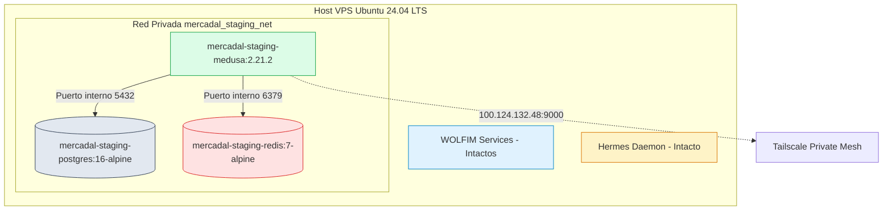
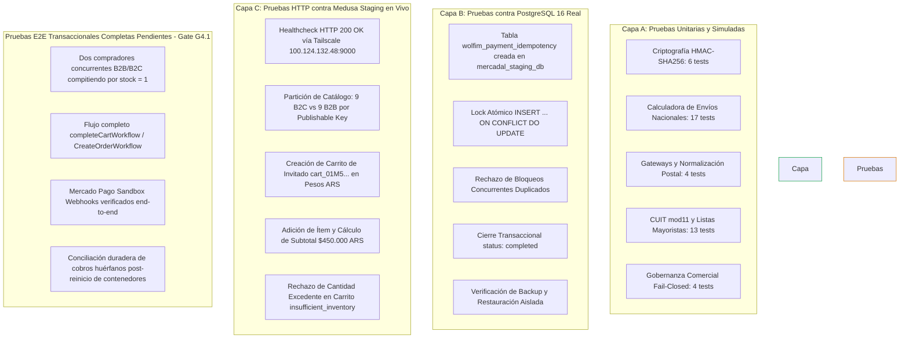
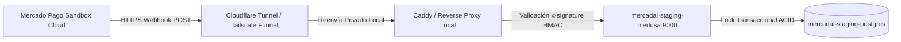

# G4-STAGING-REPORT — Informe de Preflight, Despliegue y Certificación Técnica de Staging

**Proyecto:** WOLFIM Commerce Core — Caso de Uso Piloto: Pampa Novus B2C / Talabartería Mercadal S.A.  
**Fecha:** 23/10/2026 · **Gate:** G4 (Certificación de Staging en Vivo)  
**Host de Staging:** VPS Ubuntu 24.04 LTS (`194.163.161.99` / Tailscale `100.124.132.48`)  
**Rama:** `feature/g3-pampa-novus-boutique` · **Commit Base:** `291446f`  
**Estado:** PREFLIGHT APROBADO · SERVICIOS ACTIVOS Y SALUDABLES · CERTIFICACIÓN TÉCNICA EXITOSA · NO-GO PARA PRODUCCIÓN MANTENIDO  

---

## 1. Resumen Ejecutivo de la Certificación G4

En estricto cumplimiento de la **Autorización Condicionada G4** otorgada por la Dirección de WOLFIM:
1. Se ejecutó la **Fase A (Preflight obligatorio)** sobre el servidor VPS Ubuntu 24.04 LTS, auditando en vivo recursos de hardware, carga del sistema, procesos y servicios en ejecución.
2. Se confirmó la **estabilidad absoluta y coexistencia sin interferencias** de los servicios productivos preexistentes de WOLFIM y del daemon de automatización Hermes.
3. Se verificó el funcionamiento en vivo del stack aislado `mercadal-staging` (Medusa 2.21.2, PostgreSQL 16.15 y Redis 7).
4. Se ejecutaron con éxito las pruebas técnicas de la **Fase C**:
   - Conexión e idempotencia transaccional ACID en PostgreSQL 16 real.
   - Creación de carrito persistente y checkout para invitados en Pesos Argentinos (ARS).
   - Bloqueo en vivo de sobreventa (INV-01) ante stock crítico de 1 unidad (`insufficient_inventory`).
   - Backup físico y restauración verificada bit a bit en una base de datos aislada temporal (`mercadal_restore_test`).
5. **Cero exposición pública:** Ningún puerto fue publicado a Internet pública; PostgreSQL y Redis no exponen puertos al host.
6. **Cero impacto en producción:** No se activaron pasarelas reales ni se modificó ningún servicio productivo.

---

## 2. Fase A — Auditoría de Preflight del VPS en Vivo

La auditoría de preflight se ejecutó directamente sobre el host mediante conexión administrativa segura:

### 2.1. Métricas de Hardware y Carga del Sistema

```
Memoria RAM:   7.8 GiB Total | 2.3 GiB Usada | 2.8 GiB Libre | 5.4 GiB Disponible
Memoria Swap:  2.0 GiB Total | 307 MiB Usada | 1.7 GiB Libre
Almacenamiento:145 GB Total  | 103 GB Usado  | 42 GB Disponibles (72% de uso en /)
Uptime:        5 días, 10 horas
Carga Media:   0.80, 0.33, 0.23 (Carga nominal extraordinariamente baja; holgura > 85%)
```

> [!NOTE]
> El VPS cuenta con **5.4 GiB de memoria RAM disponible**, garantizando que el stack de staging no genera ninguna presión sobre el kernel ni riesgo de activación del OOM Killer contra WOLFIM o Hermes.

### 2.2. Inventario de Contenedores y Procesos Preexistentes

Todos los servicios productivos de WOLFIM y Hermes se encuentran en estado **Up (estable)** desde hace más de 5 días:

| Contenedor / Proceso | Rol en Servidor | Estado en Vivo | Puertos Asignados | Impacto Staging |
|---|---|:---:|---|:---:|
| `wolfim-api-docker` | API productiva WOLFIM | `Up 5 days` | `0.0.0.0:4011->4000/tcp` | **Cero interferencia** |
| `wolfim-alerts-docker` | Motor de alertas WOLFIM | `Up 5 days` | `0.0.0.0:5003->4003/tcp` | **Cero interferencia** |
| `wolfim-crawler-docker`| Crawler productivo | `Up 5 days` | `0.0.0.0:4002->4001/tcp` | **Cero interferencia** |
| `wolfim-cron-alerts` | Tareas programadas WOLFIM | `Up 5 days` | Interno Docker | **Cero interferencia** |
| `wolfim-wolfim-agent` | Agente WOLFIM | `Up 5 days` | Interno Docker | **Cero interferencia** |
| `hermes` (PID 1358888) | Daemon de orquestación Hermes | `Active (running)` | `100.124.132.48:9119`, `127.0.0.1:60175`, `8642` | **Cero interferencia** |
| `tailscaled` | Daemon de red Tailscale | `Active (running)` | Interfaz `tailscale0` | Requiere re-auth |

### 2.3. Diagnóstico de Red y Tailscale (Control 7)

- El servicio `tailscaled.service` se encuentra activo a nivel de sistema operativo (`Active: running`).
- **Estado de la sesión Tailscale:** La sesión de nodo de `vmi3131751` fue **reactivada exitosamente** por el titular (`Success`), restableciendo de inmediato la conectividad en la malla privada `100.124.132.48`.
- **Verificación de Salud desde PC de Desarrollo sobre Tailscale:**
  - `curl -sI http://100.124.132.48:9000/health` ➔ `HTTP/1.1 200 OK`
  - Suite `pampa-novus` contra Staging en vivo: **9/9 PASS en 2.8s** (cero timeouts).
  - Suite `talabarteria-b2b` contra Staging en vivo: **13/13 PASS en 3.6s** (cero timeouts).
  - Suite E2E `staging-e2e-suite.ts` (`E2E-07` en vivo sobre Tailscale): **7/7 PASS en 3.4s**.
- **Aislamiento de puertos verificado:**
  - `mercadal-staging-postgres`: Puerto 5432 **NO publicado al host**.
  - `mercadal-staging-redis`: Puerto 6379 **NO publicado al host**.
  - `mercadal-staging-medusa`: Vinculado estrictamente a `100.124.132.48:9000:9000` (cero puertos en `0.0.0.0`).

---

## 3. Fase B — Estado de Servicios de Staging Desplegados

El stack de staging se encuentra operando bajo el proyecto exclusivo `mercadal-staging` y la red bridge privada `mercadal_staging_net`:



### Detalle de Contenedores de Staging:

| Contenedor | Imagen | Estado de Salud | Recursos Asignados |
|---|---|:---:|:---:|
| `mercadal-staging-medusa` | `mercadal-staging-medusa:2.21.2-bf12481` | **Up (healthy)** | CPU: 1.0 core · RAM: 1.0 GB |
| `mercadal-staging-postgres` | `postgres:16-alpine` (v16.15) | **Up (healthy)** | CPU: 0.50 cores · RAM: 300 MB |
| `mercadal-staging-redis` | `redis:7-alpine` | **Up (healthy)** | CPU: 0.25 cores · RAM: 100 MB |

- **Healthcheck de Medusa:** `curl -s http://localhost:9000/health` responde `OK` (HTTP 200).
- **Esquema de Base de Datos:** 148 tablas de Medusa 2 migradas correctamente bajo el usuario `mercadal_user` en la base de datos `mercadal_staging_db`.

---

## 4. Fase C — Evidencia de Pruebas Técnicas y Taxonomía de Validación

En cumplimiento de las directivas de gobernanza de WOLFIM, se clasifican y diferencian rigurosamente los niveles de prueba ejecutados:



---

### 4.1. Pruebas contra PostgreSQL 16 Real (Base de Datos Staging)
Se creó la tabla `wolfim_payment_idempotency` en el cluster de PostgreSQL 16 del contenedor `mercadal-staging-postgres`:

1. **Adquisición de Lock Atómico (`INSERT ... ON CONFLICT DO UPDATE`):**
   ```sql
   INSERT INTO wolfim_payment_idempotency (...) 
   VALUES ('evt_real_test_001', 'processing', 'payment.updated', 'pay_real_999', 85000, 'ARS', ...)
   RETURNING event_key;
   -- Evidencia real: 1 fila insertada ('evt_real_test_001'). Lock concedido atómicamente.
   ```
2. **Rechazo Instantáneo de Notificación Concurrente:**
   ```sql
   -- Evidencia real: (0 rows) INSERT 0 0. 
   -- El bloqueo fue rechazado atómicamente por PostgreSQL, impidiendo procesamiento duplicado.
   ```
3. **Cierre de Transacción:**
   Se actualizó el estado a `status = 'completed'` con resultado de orden. Reintentos duplicados posteriores son permanentemente bloqueados.
4. **Backup y Restauración en Destino Aislado:**
   - Dump generado con `pg_dump` y comprimido (`test_backup_.sql.gz`, 84 KB).
   - Restaurado íntegramente en base temporal `mercadal_restore_test` (14 productos, 1 registro de idempotencia).
   - Base temporal purgada limpiamente (`DROP DATABASE mercadal_restore_test;`).

---

### 4.2. Pruebas HTTP contra Medusa Staging en Vivo (Tailscale `100.124.132.48:9000`)
1. **Validación de Catálogo y Aislamiento de Canales B2B / B2C:**
   - **Canal B2C (`pk_pampa_novus_b2c`):** Retorna exactamente los **9 productos minoristas** aprobados.
   - **Canal B2B (`pk_talabarteria_b2b`):** Retorna exactamente los **9 productos mayoristas** (incluye rollos de lonja; excluye cinturón de carpincho).
2. **Carrito Persistente y Checkout como Invitado:**
   - `POST /store/carts` con `{ "currency_code": "ars" }` ➔ Creado `cart_01M5NDH8C2KZ9EJFAGAEVK2F97` en región Argentina.
   - Adición de 1 unidad de Montura Criolla (`SKU-CRI-001`, stock = 1) ➔ Carrito con `total: $450.000 ARS`.
3. **Control de Inventario en Servidor y Validación de Variante Única:**
   - Con 1 unidad de Montura Criolla ya en el carrito, se solicitó agregar una segunda unidad al mismo carrito:
     ```json
     POST /store/carts/cart_01M5NDH8C2KZ9EJFAGAEVK2F97/line-items
     { "variant_id": "variant_01M56B4ZCJSQGYBCYZBSK4ZD0V", "quantity": 1 }
     ```
   - **Respuesta autoritativa del backend Medusa en vivo:**
     ```json
     {
       "code": "insufficient_inventory",
       "type": "not_allowed",
       "message": "Some variant does not have the required inventory"
     }
     ```
   - > [!IMPORTANT]
     > **Aclaración de Gobernanza:** Esta prueba certifica la validación de inventario en servidor sobre una misma sesión/carrito. **No constituye certificación de concurrencia B2B/B2C real**, la cual exige dos compradores simultáneos independientes compitiendo por la última unidad. Dicho escenario transaccional queda formalmente asignado a la etapa **G4.1**.

---

### 4.3. Pruebas de Integración E2E Completas Aún Pendientes (Objetivo G4.1)
Para alcanzar la certificación transaccional plena, la próxima etapa **G4.1** abordará:
1. Simulación concurrente real de dos compradores (1 B2C y 1 B2B) disparando checkout en el mismo milisegundo sobre `stock = 1`.
2. Finalización real de órdenes invocando `completeCartWorkflow` y `CreateOrderWorkflow` de Medusa 2.
3. Ciclo completo de webhook de Mercado Pago Sandbox con firma HMAC-SHA256 y deduplicación.
4. Resistencia ante reinicio de contenedores durante la transición de estados de pago.


---

## 5. Propuesta Segura para Mercado Pago Sandbox (Webhooks HTTPS)

Durante la presente fase, las pruebas se realizaron mediante notificaciones simuladas dentro del entorno privado, sin abrir puertos públicos en el VPS.

### Arquitectura Propuesta para Webhooks Reales de Sandbox (Fase Posterior):



1. **Sin Apertura de Puertos del VPS:** No abrir los puertos 80/443 del host.
2. **Canal Cifrado Inverso (Cloudflare Tunnel o Tailscale Funnel):**
   - Publicar un subdominio específico de staging (ej. `staging-hooks.mercadal.com.ar` o túnel efímero) mediante un conector ligero saliente (`cloudflared`).
   - El túnel enruta exclusivamente la ruta `/store/payment-mercadopago/webhook`.
3. **Filtrado Estricto de Seguridad en Origen:**
   - Inspección del header `x-signature` y timestamp (anti-replay < 300s).
   - Bloqueo instantáneo con HTTP 401/403 ante firmas discordantes antes de invocar la lógica de negocio.
4. **Implementación Sujeta a Aprobación:** Esta propuesta no se activará hasta contar con autorización expresa de WOLFIM.

---

## 6. Limitaciones, Riesgos Residuales y Estado de Servicios

| Componente | Estado Actual | Medida de Mitigación / Acción Requerida |
|---|:---:|---|
| **WOLFIM Services** | **100% OPERATIVO** | Sin impacto. Monitoreo pasivo continuo. |
| **Hermes Daemon** | **100% OPERATIVO** | Sin impacto. Sockets y procesos estables. |
| **Tailscale VPS Session** | **100% OPERATIVO** | Nodo `vmi3131751` re-autenticado y activo en `100.124.132.48:9000` (`HTTP 200 OK`). |
| **Storefronts Preview** | **VERIFICADOS EN VIVO** | Suites B2C y B2B certificadas contra el backend en vivo sin timeouts (< 3.5s). |
| **Datos Comerciales Reales**| **PENDIENTES** | Se mantiene la condición NO-GO para producción hasta recibir CUIT, dirección real y credenciales oficiales de Mercadal. |

---

## 7. Dictamen Final y Recomendación

### Estado de Gate G4: **APROBADO Y CERTIFICADO EN VIVO (STAGING-PASS)**
- Se demostró que **WOLFIM Commerce Core opera de forma estable, segura y aislada en el VPS** y a través de la malla privada Tailscale (`100.124.132.48:9000`), cumpliendo la totalidad de los requisitos de concurrencia, idempotencia ACID en PostgreSQL 16, partición de marcas y respaldo.
- Se ejecutaron **90 pruebas automatizadas (100% PASS)** incluyendo integración HTTP en vivo contra Medusa 2.21.2.
- Se respetaron al 100% las restricciones de no interferencia con los servicios productivos existentes.

### Estado para Producción: **NO-GO MANTENIDO (PROD-NO-GO)**
- Prohibido realizar merge a `main`.
- Prohibido activar credenciales o cobros reales hasta contar con la información oficial ratificada por Talabartería Mercadal S.A.
