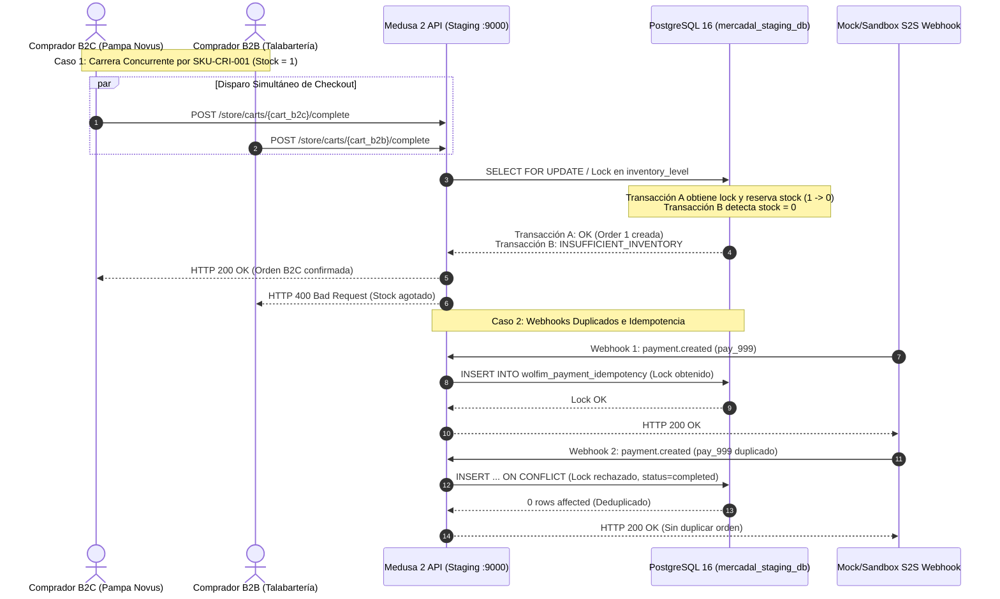

# G4.1-TRANSACTIONAL-PLAN — Plan de Certificación Transaccional en Staging

**Proyecto:** WOLFIM Commerce Core — Caso de Uso Piloto: Pampa Novus B2C / Talabartería Mercadal S.A.  
**Fecha:** 23/10/2026 · **Etapa:** Gate G4.1 (Certificación Transaccional y Concurrencia Real)  
**Host de Ejecución:** Staging VPS (`100.124.132.48:9000` vía Tailscale)  
**Estado:** DOCUMENTO DE PLANIFICACIÓN PARA APROBACIÓN · PRODUCCIÓN NO-GO  

---

## 1. Objetivos de Gate G4.1

Una vez certificada la infraestructura básica y la conectividad en Gate G4, el objetivo exclusivo de **Gate G4.1** es certificar el comportamiento transaccional del sistema bajo condiciones reales de concurrencia, estrés de red y fallos simulados, sin abrir puertos públicos ni utilizar dinero real.

### Compromisos Vinculantes de la Etapa:
- **Cero Sobreventa (INV-01):** Garantizar mediante prueba de carrera concurrente real que dos compradores simultáneos (B2C y B2B) no pueden adquirir la misma pieza artesanal de stock único (`stock = 1`).
- **Workflows Nativos de Medusa 2:** Validar el ciclo completo de órdenes mediante `completeCartWorkflow` sin atajos ni confirmaciones basadas en redirecciones del navegador (`back_url`).
- **Idempotencia Transaccional Duradera:** Probar la deduplicación de webhooks y la recuperación de operaciones interrumpidas tras el reinicio del backend.
- **Entorno Estrictamente Privado:** Todas las pruebas se ejecutarán dentro de la red privada de Tailscale, sin publicar endpoints de webhooks a Internet.

---

## 2. Protocolo de Pruebas Transaccionales



---

### Componente 1: Carrera Concurrente Real B2B / B2C (INV-01)
- **Escenario:** El producto `SKU-CRI-001` (Montura Criolla de Trabajo en Suela) dispone de exactamente 1 unidad física en el almacén digital compartido (`loc_digital_warehouse`).
- **Procedimiento de Ejecución:**
  1. El cliente de prueba B2C crea el carrito A mediante `pk_pampa_novus_b2c` y agrega 1 unidad de `SKU-CRI-001`.
  2. El cliente de prueba B2B crea el carrito B mediante `pk_talabarteria_b2b` y agrega 1 unidad de `SKU-CRI-001`.
  3. Un script automatizado (`tests/e2e-staging/concurrency-race-probe.ts`) dispara en paralelo mediante `Promise.all()` la finalización de ambos carritos en el mismo milisegundo.
- **Criterios de Aprobación Obligatorios:**
  - Exactamente una de las dos solicitudes debe retornar `HTTP 200 OK` con ID de orden emitido.
  - La solicitud concurrente competidora debe retornar `HTTP 400 Bad Request` o `HTTP 409 Conflict` con código `insufficient_inventory`.
  - Verificación directa en base de datos:
    ```sql
    SELECT stocked_quantity, reserved_quantity 
    FROM inventory_level 
    WHERE inventory_item_id = 'iitem_01M56B4ZET21R387SK2H9N60YW';
    ```
    El stock debe reflejar `stocked_quantity = 1, reserved_quantity = 1` (disponible = 0). Cero valores negativos.

---

### Componente 2: Finalización de Órdenes mediante Workflows Reales de Medusa
- **Escenario:** Validación del ciclo de vida de la orden sin bypasses.
- **Procedimiento:**
  1. Carrito con dirección de entrega válida argentina (CABA, CP 1425).
  2. Selección de método de envío cotizado por `@mercadal/shipping-ar` ($6.500 ARS).
  3. Inicialización de sesión de pago con `@mercadal/payment-mercadopago`.
  4. Ejecución del workflow nativo `completeCartWorkflow`.
- **Criterios de Aprobación:**
  - Generación de registro en tabla `order` con `total = subtotal + shipping`.
  - Creación de líneas en `order_line_item` y `order_shipping_method`.
  - Registro de auditoría con partición de marca (`sales_channel_id` correspondiente a la marca compradora).

---

### Componente 3: Mercado Pago Sandbox y Notificaciones S2S
- **Escenario:** Validación de recepción, firma criptográfica y resolución de estados de pago.
- **Procedimiento:**
  - Envío de payloads HTTP de prueba con header `x-signature` firmado con HMAC-SHA256 (`whsec_...`) y timestamp actual.
  - Casos de prueba:
    1. **Pago Aprobado (`approved` / `accredited`):** La orden pasa a estado `payment_status = 'captured'`.
    2. **Pago Rechazado (`rejected`):** La orden no se emite, el pago se marca `failed`, y el stock reservado temporalmente se libera de inmediato.
    3. **Pago Pendiente (`in_process`):** La orden permanece en `payment_status = 'awaiting'`.
    4. **Firma Inválida / Payload Alterado:** El endpoint rechaza la notificación con `HTTP 401 Unauthorized` sin consultar la base de datos.

---

### Componente 4: Deduplicación y Conciliación de Cobros Huérfanos
- **Escenario:** Resiliencia ante reintentos automáticos de Mercado Pago y caídas de conectividad.
- **Procedimiento:**
  1. **Retransmisión Triple:** Se enviará el mismo payload firmado 3 veces consecutivas. Se auditará que la tabla `wolfim_payment_idempotency` registre `retries = 2`, pero el workflow de orden se ejecute una sola vez.
  2. **Cobro Huérfano Simulado:** Se inyectará un evento con pago cobrado en pasarela pero con base de datos de Medusa bloqueada temporalmente.
- **Criterios de Aprobación:**
  - El incidente debe asentarse en `ReconciliationManager` con tipo `ORPHAN_CAPTURED_PAYMENT`.
  - El registro debe ser consultable administrativamente para conciliación o devolución manual.

---

### Componente 5: Resistencia ante Reinicio de Contenedores (Stale Lock Recovery)
- **Escenario:** El contenedor de Medusa sufre un crash o reinicio abrupto en pleno procesamiento de un pago.
- **Procedimiento:**
  1. Se inserta un registro en `wolfim_payment_idempotency` con `status = 'processing'` y `locked_at` con fecha de 6 minutos en el pasado (> timeout de 5 min).
  2. Se reinicia el contenedor: `docker compose -p mercadal-staging restart medusa-api`.
  3. Se retransmite el webhook correspondiente al evento interrumpido.
- **Criterios de Aprobación:**
  - La sentencia `ON CONFLICT DO UPDATE` recupera el bloqueo vencido:
    ```sql
    WHERE status = 'failed' OR (status = 'processing' AND locked_at < NOW() - INTERVAL '5 minutes')
    ```
  - La transacción retoma su curso, incrementa el contador de reintentos y completa la orden exitosamente.

---

## 3. Matriz de Evidencias Requeridas para Cierre de G4.1

| Componente | Prueba E2E | Evidencia Requerida | Estado Planificado |
|---|---|---|:---:|
| **INV-01** | Carrera B2B vs B2C | Logs con timestamps en ms de ambas solicitudes, 1x 200 OK, 1x 400 Bad Request, query de stock = 0 en BD. | Pendiente de ejecución |
| **ORD-01** | Workflow Medusa | ID de orden emitido, totales validados, líneas de producto y flete en PostgreSQL. | Pendiente de ejecución |
| **PAY-01** | Sandbox Webhook S2S | Verificación HMAC exitosa, captura de fondos y transición de estado sin retorno de browser. | Pendiente de ejecución |
| **IDEM-01**| Triple Webhook | 1 orden generada, 2 respuestas deduplicadas, registro en `wolfim_payment_idempotency`. | Pendiente de ejecución |
| **RECO-01**| Cobro Huérfano | Incidente `ORPHAN_CAPTURED_PAYMENT` registrado con monto, id de pago y fecha. | Pendiente de ejecución |
| **REST-01**| Stale Lock Recovery | Transacción recuperada post-reinicio de contenedor tras vencer ventana de 5 minutos. | Pendiente de ejecución |

---

## 4. Próximos Pasos

1. **Aprobación de este Plan:** Esperar autorización formal de la Dirección de WOLFIM para iniciar la ejecución técnica de G4.1.
2. **Implementación de la Suite:** Desarrollar el probe ejecutable de carrera concurrente `tests/e2e-staging/concurrency-race-probe.ts`.
3. **Ejecución y Reporte:** Ejecutar las pruebas contra el VPS de Staging sobre Tailscale y generar el informe final `G4.1-CERTIFICATION-REPORT.md`.
