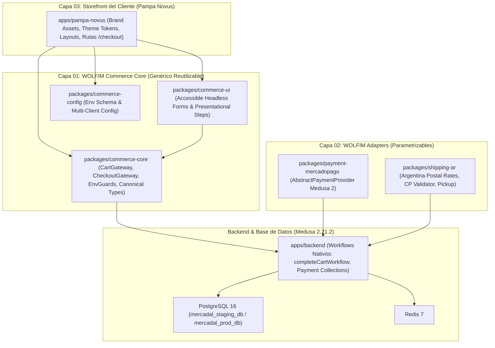

# ADR-001: Fronteras de Reutilización, Responsabilidades y Paquetes en WOLFIM Commerce Core

**Estado:** Aprobado con Condiciones Incorporadas  
**Fecha:** 23/10/2026  
**Contexto:** Transición de Pampa Novus a Producción y Construcción de la Plataforma Base WOLFIM Commerce Core  
**Decisores:** Antigravity (Arquitecto de Solución), Responsable Técnico WOLFIM  

---

## 1. Contexto del Problema

Pampa Novus es el caso de uso piloto de la plataforma de e-commerce de **WOLFIM**. Actualmente, el storefront B2C posee un diseño editorial boutique aprobado y componentes de catálogo funcionales, pero la lógica transaccional de carrito reside acoplada al navegador del cliente en `localStorage` (`CartContext.tsx`), sin persistencia en el backend ni reservas de inventario.

Para llevar Pampa Novus a producción y al mismo tiempo capitalizar los componentes comerciales para futuros clientes de WOLFIM, se requiere desacoplar el núcleo transaccional sin reinventar las capacidades nativas de Medusa 2 ni convertir la infraestructura en un SaaS multi-tenant riesgoso.

---

## 2. Decisión Arquitectónica y Condiciones Obligatorias

Se aprueba la arquitectura desacoplada en tres capas (`WOLFIM Commerce Core`, `WOLFIM Adapters` y `Storefront de Cliente`), sujeta a las siguientes **7 condiciones mandatorias**:

### Condición 1: Medusa 2 como Autoridad Absoluta
- **Medusa 2** es la única fuente de verdad para el ciclo de vida del carrito (`/store/carts`), cálculo de precios según región e impuestos (IVA 21% ARS), reglas de descuento, reservas de stock digital y órdenes de compra.
- El cliente frontend jamás calcula, muta ni impone totales, subtotales ni disponibilidad de inventario. El navegador solo refleja el estado validado por el servidor.

### Condición 2: Uso Estricto de Workflows Nativos y Flujos Oficiales de Medusa 2
- El ciclo de checkout debe cerrarse obligatoriamente mediante `completeCartWorkflow` de Medusa 2.
- Queda **terminantemente prohibido** implementar atajos paralelos de confirmación de órdenes (como mutaciones directas a base de datos o endpoints custom que generen órdenes saltándose los pasos de reserva y pago).
- Las sesiones de pago se gestionan a través de los módulos nativos de Medusa (`PaymentCollection` -> `PaymentSession`).

### Condición 3: Política de Dependencias Diferenciada por Tipo de Paquete
Se establece una estricta segregación de dependencias para evitar acoplamientos circulares o fugas de código de backend al frontend:
1. **Paquetes de UI Frontend (`packages/commerce-ui`)**:
   - Componentes presentacionales, accesibles (ARIA) y tematizables (`CheckoutContactStep`, `CheckoutAddressStep`, `ShippingMethodSelector`, `OrderSummaryCard`).
   - Dependen únicamente de React y utilitarios cosméticos (`clsx`, `tailwind-merge`).
   - No contienen lógica de red ni dependencias de SDK; reciben datos tipados y emiten callbacks.
2. **Paquetes de SDK/Servicios Frontend (`packages/commerce-core`)**:
   - Fachadas tipadas de comunicación (`CartGateway`, `CheckoutGateway`, `EnvGuards`).
   - Dependen de `@medusajs/js-sdk` (v2.21.2) y tipos canónicos.
   - Agnósticos de React UI y sin referencias a ninguna marca o cliente particular.
3. **Proveedores y Módulos de Backend (`packages/payment-mercadopago`, `packages/shipping-ar`)**:
   - Módulos del servidor que se conectan al contenedor de Medusa 2.
   - Heredan de clases base oficiales de `@medusajs/framework/utils` (`AbstractPaymentProvider`, `AbstractFulfillmentProviderService`).
   - Tienen prohibido cualquier vínculo con dependencias de frontend o paquetes de Next.js.
4. **Storefronts de Clientes (`apps/pampa-novus`)**:
   - Importan `commerce-core` y `commerce-ui` inyectando sus estilos, tipografías y textos de marca.
   - **Regla inquebrantable**: `apps/pampa-novus -> packages/commerce-* -> @medusajs/js-sdk`. Prohibido que `packages/*` importe desde `apps/*`.

### Condición 4: Bloqueo Explícito de Mocks por Variable de Entorno Fail-Closed
- Para garantizar que jamás se vendan productos ficticios o con precios desactualizados si el backend sufre una caída en producción:
  - Se implementa el guardia de entorno `NEXT_PUBLIC_ALLOW_MOCK_FALLBACK`.
  - **Política Fail-Closed:** A menos que `NEXT_PUBLIC_ALLOW_MOCK_FALLBACK === 'true'` esté explícitamente configurado en el archivo de entorno de desarrollo local, cualquier fallo de conexión con Medusa resultará en un error controlado de servicio (`ServiceUnavailableError`), bloqueando la navegación a checkout.
  - En Staging y Producción, la variable queda indefinida o fijada en `false`, impidiendo el uso de `STATIC_B2C_FALLBACK_PRODUCTS`.

### Condición 5: Aislamiento Estricto de Datos e Infraestructura entre Clientes WOLFIM
- La plataforma WOLFIM operará bajo el modelo **Single-Tenant por Cliente / Multi-Implementación Parametrizable**.
- Cada cliente futuro de WOLFIM poseerá su propia instancia de Medusa, su base de datos PostgreSQL, su Redis y sus credenciales de pago.
- La compartición de catálogo maestro e inventario por SKU entre Pampa Novus (B2C) y Talabartería Mercadal (B2B) es una **excepción deliberada intra-Mercadal S.A.** (misma empresa titular). Jamás se albergarán clientes externos en una misma base de datos.

### Condición 6: Pruebas Empíricas de Concurrencia de Inventario B2B/B2C
- No se asume a priori que el problema de concurrencia esté resuelto.
- Se diseñará una suite de pruebas de concurrencia automatizada (`concurrency-stress.test.ts`) que ejecute dos solicitudes de compra simultáneas (`Promise.all`) compitiendo por un SKU con stock digital exactamente igual a 1 (`initialStock: 1`).
- La prueba verificará de forma empírica que exactamente una solicitud obtenga `200 OK` (orden creada) y la otra sea rechazada con error de stock insuficiente (`409 Conflict / 400 Insufficient Inventory`), comprobando que no existe sobreventa (*overselling*) entre canales.

### Condición 7: Contrato de Integración con Mercado Pago (Idempotencia y Conciliación)
Antes de iniciar la CAPA 02 (Gate G2), queda definido el contrato técnico de integración para cobros:
1. **Creación de Pagos:** El checkout inicia la sesión de pago delegando en el backend de Medusa 2 (`initiatePayment`), el cual genera la preferencia/orden oficial en Mercado Pago. El monto y los ítems provienen del carrito validado en el servidor.
2. **Verificación Criptográfica:** El endpoint de webhooks valida obligatoriamente la cabecera `x-signature` y el timestamp contra el secreto del webhook (`MP_WEBHOOK_SECRET`). Notificaciones no firmadas son rechazadas inmediatamente con HTTP 401.
3. **Consulta Server-to-Server:** El webhook no confía en el estado del payload recibido. Al llegar un evento, Medusa ejecuta una consulta autenticada a la API de Mercado Pago (`GET /v1/payments/{id}`) para verificar el estado real y el monto acreditado.
4. **Idempotencia Absoluta:** Cada evento se deduplica mediante un registro transaccional en base de datos. Eventos repetidos se responden con HTTP 200 sin re-ejecutar workflows ni duplicar órdenes.
5. **Separación de Retorno Frontend:** La URL de retorno (`back_url`) solo cumple fines de experiencia de usuario en el navegador. La orden solo se marca como pagada cuando el webhook autenticado confirme la acreditación.
6. **Manejo de Discrepancias:** Si un pago es aprobado en Mercado Pago pero ocurre un error al completar la orden en Medusa, el sistema registra el incidente en una tabla de conciliación y emite alerta para intervención manual sin pérdida de fondos ni entrega involuntaria.

---

## 3. Consecuencias y Roadmap de Gates

- **G1 (En curso):** Implementación de `packages/commerce-core` y `packages/commerce-ui`, carrito Medusa 2 persistente, checkout invitado accesible y pruebas de concurrencia.
- **G2 (Bloqueado hasta aprobación de G1):** Módulos `payment-mercadopago` y `shipping-ar` en sandbox.
- **G3 (Bloqueado hasta aprobación de G2):** Integración boutique en Pampa Novus, páginas legales y carga de 15 SKUs reales.
- **G4 & G5:** Preproducción y pase a Producción bajo autorización explícita.
