# Plan de Implementación y Prueba de Concepto — Mercadal Digital 360

## 1. Hoja de Ruta por Fases y Criterios de Control

El desarrollo se organiza en etapas sucesivas con puntos de control (*gates*) de aprobación obligatoria. Ninguna fase avanza sin la validación explícita del usuario.

```mermaid
flowchart LR
    Fase0["Fase 0: Planificación & Arquitectura (Completada)"] --> Fase1["Fase 1: Monorepo Local & Setup Staging VPS"]
    Fase1 --> Fase2["Fase 2: Backend Medusa 2 en Staging VPS"]
    Fase2 --> Fase3["Fase 3: Prueba de Concepto (PoC 10 Productos)"]
    Fase3 --> Fase4["Fase 4: Storefront B2C Pampa Novus (Local)"]
    Fase4 --> Fase5["Fase 5: Storefront B2B Talabartería (Local)"]
    Fase5 --> Fase6["Fase 6: Spikes de Integración Argentina"]
    Fase6 --> Fase7["Fase 7: Preparación Producción VPS"]
```



---

### Fase 0: Planificación, Seguridad y Arquitectura (Estado: COMPLETADA)
- Arquitectura híbrida aprobada (desarrollo local de storefronts en Windows 11 + backend y base de datos en VPS Staging).
- Modelo de seguridad multicapa y cero exposición pública de bases de datos o panel admin.
- Diseño de pruebas de concurrencia e identificación de workflows de inventario (`completeCartWorkflow`, `cancelOrderWorkflow`).
- Matriz de 10 productos de prueba con escalas de volumen coherentes con el stock.
- Presupuesto de memoria para Staging (< 900 MB RAM) y protocolo estricto de protección para WOLFIM, Hermes y Tailscale.
- Adopción de **Node.js 24 LTS** como opción primaria para los storefronts locales y el backend contenerizado.

---

### Fase 1: Monorepo Local y Preparación Segura de Staging en VPS
- **Objetivo**: Inicializar el repositorio Git y monorepo en la máquina Windows local, y preparar de forma no destructiva el entorno Staging en el VPS.
- **Acciones en Local (Windows 11)**:
  1. Inicializar Git (`git init`) en `c:\Projects\mercadal-digital360`.
  2. Configurar la estructura de **Turborepo** (`turbo.json`) y workspaces de npm/pnpm.
  3. Configurar TypeScript (`tsconfig.base.json`), ESLint y Prettier.
  4. Configurar plantillas de variables de entorno seguras (`.env.example`) sin secretos reales.
  5. Configurar conexión segura al backend remoto mediante la IP privada de **Tailscale** o túnel SSH (`localhost:9000 -> VPS:9000`).
- **Acciones en VPS Staging (Ubuntu 24.04 LTS)**:
  *(Sujetas a autorización previa del usuario en cada paso)*
  1. *Auditoría Previa de Puertos*: Inspeccionar puertos en uso en el VPS (`ss -tulpn`) para verificar que los puertos 5432, 6379 y 9000 no colisionen con WOLFIM o Hermes.
  2. *Creación de Directorio Aislado*: Crear `~/mercadal-staging/` con permisos restringidos (`chmod 700`).
  3. *Generación de `docker-compose.staging.yml`*: Definir los servicios con nombre de proyecto exclusivo `mercadal-staging`:
     - `mercadal_staging_postgres` (PostgreSQL 16)
     - `mercadal_staging_redis` (Redis 7)
     - Red interna `mercadal_staging_net`
     - Volúmenes `mercadal_staging_pgdata` y `mercadal_staging_redisdata`
  4. *Generación de `.env.staging` en VPS*: Claves criptográficas y contraseñas generadas in-situ en el servidor (nunca versionadas en Git).
  5. *Comprobación de Aislamiento*: Levantar PostgreSQL y Redis de staging sin reiniciar Docker daemon ni alterar contenedores existentes.
- **Criterio de Salida**: Conexión exitosa desde la estación local al PostgreSQL de Staging a través del túnel seguro de Tailscale/SSH, y WOLFIM/Hermes operando con normalidad.

---

### Fase 2: Despliegue y Consolidación del Backend Medusa 2 en Staging
- **Objetivo**: Levantar Medusa 2 con sus módulos B2B en el entorno Staging del VPS.
- **Acciones Concretas**:
  1. Construir e inicializar la imagen del backend Medusa 2 con los módulos B2B consolidados (`company`, `quote`, `approval`).
  2. Ejecutar migraciones en la base de datos `mercadal_staging_db` mediante `npx medusa db:migrate`.
  3. Ejecutar script de seed de configuración base:
     - Almacén de inventario digital único: `loc_digital_warehouse`.
     - Canal B2C: `sc_pampa_novus_b2c` con `pk_b2c`.
     - Canal B2B: `sc_talabarteria_b2b` con `pk_b2b`.
     - Vinculación de ambos canales al almacén digital.
     - Grupo comercial mayorista `cg_mayoristas_aprobados`.
  4. Configurar middleware de seguridad multicapa (guards de `Company` para rutas B2B y scoping mandatorio de órdenes por canal).
- **Criterio de Salida**: Medusa 2 respondiendo en `http://<tailscale-ip>:9000/health` o vía túnel SSH, con panel Medusa Admin accesible de forma privada y autenticada.

---

### Fase 3: Ejecución de la Prueba de Concepto (PoC)
- **Objetivo**: Demostrar empíricamente los 6 pilares de la arquitectura sobre los 10 productos de prueba antes de construir las pantallas definitivas.
- **Acciones Concretas**:
  1. Cargar el dataset de los 10 productos maestros en la base de datos de Staging.
  2. Ejecutar la suite automatizada de pruebas:
     - Test Suite 1: Catálogo Maestro común visible en ambos canales.
     - Test Suite 2: Precios minoristas vs mayoristas base y tiers por volumen.
     - Test Suite 3: Condiciones comerciales y Company Guard.
     - Test Suite 4: Concurrencia e inventario compartido (`completeCartWorkflow` bajo peticiones simultáneas).
     - Test Suite 5: Consistencia ante cancelaciones (`cancelOrderWorkflow`) y devoluciones (`receiveReturnWorkflow`).
     - Test Suite 6: Pruebas de acceso cruzado y seguridad (Penetration / Boundary Tests).
  3. Emitir reporte de resultados con métricas de tiempo y consistencia de datos.
- **Criterio de Salida**: 100% de los tests en estado PASS y aprobación formal del usuario.

---

### Fase 4: Storefront B2C (Pampa Novus)
- **Objetivo**: Construir el storefront minorista en Next.js 15 local con alta fidelidad al mockup de referencia provisto en el workspace.
- **Acciones Concretas**:
  1. Incorporar el sistema de diseño del mockup (tokens visuales, fuentes, paleta de colores).
  2. Desarrollar catálogo público, filtros dinámicos, búsqueda, ficha de producto responsive.
  3. Desarrollar carrito y checkout minorista en 2 pasos.
  4. Conectar con el backend de Staging utilizando `pk_b2c`.
- **Criterio de Salida**: Storefront B2C navegable y funcional, cumpliendo con la fidelidad del mockup en desktop y mobile.

---

### Fase 5: Storefront B2B (Talabartería Mercadal)
- **Objetivo**: Desarrollar el portal mayorista privado en Next.js 15 local y los flujos corporativos.
- **Acciones Concretas**:
  1. Desarrollar pantalla de acceso cerrado y formulario de registro comercial (CUIT, Razón Social, Condición IVA).
  2. Construir catálogo mayorista con visualización de escalas de volumen y pedidos en bloque.
  3. Desarrollar interfaz de cotizaciones (RFQ) y flujo de aprobación de pedidos por parte del administrador de la empresa.
  4. Conectar con el backend de Staging utilizando `pk_b2b` y autenticación corporativa.
- **Criterio de Salida**: Flujo completo B2B operativo (registro -> aprobación admin -> pedido mayorista / cotización).

---

### Fase 6: Spikes de Integración Argentina (Pendientes de Validación)
- **Objetivo**: Validar técnicamente mediante pruebas de laboratorio en sandbox/homologación cada servicio externo:
  1. *Spike Mercado Pago*: Evaluar en sandbox de staging `@nicogorga/medusa-payment-mercadopago` o módulo custom; probar Checkout Pro, Payment Bricks y webhooks con firma.
  2. *Spike Transportistas*: Implementar `IFulfillmentProvider` y probar cotizaciones por código postal con APIs de prueba de Andreani/Correo Argentino.
  3. *Spike Facturación ARCA*: Conectar `afip.js` con WSFE en entorno de Homologación; validar emisión de Factura A y B con CAE.
  4. *Spike Mercado Libre*: Diseñar y probar conector de sincronización bidireccional sobre API de Meli en staging.
- **Criterio de Salida**: Reporte de validación técnica de cada integración con pruebas en entorno de pruebas/sandbox.

---

### Fase 7: Preparación para Despliegue en Producción
- **Objetivo**: Configurar el entorno de Producción definitivo en el VPS, completamente independiente de Staging y sin tocar los servicios preexistentes.
- **Acciones Concretas**:
  1. Crear `docker-compose.prod.yml` con namespace `mercadal-prod`, base de datos `mercadal_prod_db`, volúmenes `mercadal_prod_*` y red `mercadal_prod_net`.
  2. Configurar reverse proxy (Caddy / Nginx) con certificados SSL Let's Encrypt automáticos para los dominios públicos de producción.
  3. Configurar límites de recursos (*hard limits* cgroups) y `oom_score_adj: 500`.
  4. Documentar el procedimiento de despliegue paso a paso para ser ejecutado únicamente cuando el usuario lo autorice explícitamente.
- **Criterio de Salida**: Procedimiento de despliegue a producción validado y listo para ejecución controlada.

---

## 2. Procedimiento Seguro de Despliegue en Staging (Paso a Paso)

Para garantizar la no interferencia con WOLFIM, Hermes y Tailscale, el procedimiento de despliegue en Staging seguirá estos pasos secuenciales:

```mermaid
sequenceDiagram
    autonumber
    actor User as Usuario (Aprobador)
    participant Local as Antigravity Local
    participant VPS as VPS Ubuntu (SSH / Tailscale)
    participant Staging as Namespace mercadal-staging
    participant Services as WOLFIM / Hermes / Tailscale

    User->>Local: Autoriza inicio de despliegue Staging
    Local->>VPS: Paso 1: Pre-flight check (ss -tulpn, docker ps)
    VPS-->>Local: Reporta puertos libres y servicios activos intactos
    Note over VPS,Services: WOLFIM, Hermes y Tailscale verificados e inmunes
    
    Local->>VPS: Paso 2: Crear directorio aislado ~/mercadal-staging
    VPS-->>Local: Directorio creado con permisos 700
    
    Local->>VPS: Paso 3: Transferir docker-compose.staging.yml y generar .env.staging
    VPS-->>Local: Archivos en posición (sin secretos en Git)
    
    Local->>VPS: Paso 4: docker compose -p mercadal-staging up -d postgres redis
    VPS->>Staging: Inicia contenedores mercadal_staging_postgres y redis
    Staging-->>VPS: Contenedores en ejecución saludable
    VPS-->>Local: Status OK (Puertos locales / Tailscale vinculados)
    
    Local->>VPS: Paso 5: Healthcheck y prueba de túnel privado
    VPS-->>Local: PostgreSQL responde 'SELECT 1;' / Redis responde 'PONG'
```

### Pre-flight Checks (Paso 1)
Antes de crear cualquier archivo en el VPS, se ejecutará una inspección no destructiva de puertos y recursos:
```bash
# Verificar que los puertos estándar no colisionen con servicios existentes:
ss -tulpn | grep -E ':(5432|6379|9000)\b'
# Verificar uso actual de memoria:
free -h
# Verificar estado de Tailscale:
tailscale status
```
Si alguno de los puertos estuviese utilizado por WOLFIM o Hermes, se mapearán puertos alternativos exclusivamente para staging (ej. `5433` para Postgres, `6380` para Redis, `9001` para Medusa).

---

## 3. Protocolo de Pruebas de la PoC (10 Productos)

### Matriz de Productos de Prueba

| # | SKU | Título del Producto | Stock Digital Inicial | Precio Minorista B2C | Precio Mayorista B2B (Base) | Escala Mayorista B2B (Volumen Coherente) |
|---|---|---|---|---|---|---|
| 1 | `MERC-MONT-001` | Montura Criolla Tradicional Cuero Crudo | 6 | $450.000 | $320.000 | Tier Volumen (3 a 5 un.): $295.000 |
| 2 | `MERC-BOZ-002` | Bozal Trenzado Fino de Lonja | 40 | $85.000 | $58.000 | Tier Volumen (15 a 30 un.): $50.000 |
| 3 | `MERC-CABR-003` | Cabezada Criolla con Riendas | 25 | $120.000 | $82.000 | Tier Volumen (10 a 20 un.): $72.000 |
| 4 | `MERC-REB-004` | Rebenque Tradicional Cabo Madera y Plata | 20 | $95.000 | $65.000 | Tier Volumen (8 a 15 un.): $58.000 |
| 5 | `MERC-CINCH-005` | Cincha de Piola Pura Lana | 60 | $65.000 | $42.000 | Tier Volumen (20 a 50 un.): $36.000 |
| 6 | `MERC-ESTR-006` | Estribos Arequeros de Alpaca | 10 | $180.000 | $125.000 | Tier Volumen (4 a 8 un.): $112.000 |
| 7 | `MERC-CINT-007` | Cinturón Gaucho Bordado con Rastras | 45 | $75.000 | $48.000 | Tier Volumen (15 a 35 un.): $40.000 |
| 8 | `MERC-MAT-008` | Matera de Cuero Vacuno Repujado | 30 | $110.000 | $74.000 | Tier Volumen (10 a 25 un.): $64.000 |
| 9 | `MERC-CUCH-009` | Cuchillo Criollo Acero Carbono con Vaina | 15 | $140.000 | $95.000 | Tier Volumen (5 a 12 un.): $84.000 |
| 10 | `MERC-BAST-010` | Basto Criollo Relleno Especial | 8 | $380.000 | $260.000 | Tier Volumen (3 a 6 un.): $240.000 |

### Los 6 Escenarios de Prueba Automatizados:
1. **Test 1: Catálogo Maestro Común**: Ambos canales consultan y reciben los mismos 10 SKUs idénticos.
2. **Test 2: Precios y Escalas por Cantidad**: Consulta B2C retorna precio minorista; cliente B2B autenticado recibe precio mayorista; cantidades en tier de volumen aplican automáticamente el descuento de escala.
3. **Test 3: Condiciones Comerciales Exclusivas**: B2C permite checkout directo; B2B exige login y empresa aprobada.
4. **Test 4: Concurrencia e Inventario Compartido (Prueba de Estrés)**: Compras simultáneas concurrentes compitiendo por stock escaso en `completeCartWorkflow` sin sobreventa.
5. **Test 5: Consistencia ante Cancelación y Devolución**: Cancelación en B2B (`cancelOrderWorkflow`) restituye stock inmediatamente para B2C; devolución en B2C reajusta inventario digital.
6. **Test 6: Pruebas de Acceso Cruzado y Seguridad (Penetration Tests)**: Tokens de una marca no pueden consultar cotizaciones ni pedidos de la otra marca; inyecciones artificiales de precios en el cliente son sobreescritas por el servidor.

---

## 4. Matriz de Riesgos y Mitigaciones Actualizada

| Riesgo Técnico | Impacto | Probabilidad | Estrategia de Mitigación |
|---|---|---|---|
| **Interferencia con WOLFIM, Hermes o Tailscale en VPS** | Crítico | Baja | Prohibición absoluta de reiniciar Docker daemon. Todo se encapsula en el namespace de proyecto `mercadal-staging` con red propia, volúmenes dedicados y límites de recursos estrictos. |
| **Colisión de Puertos en el VPS** | Alto | Media | Verificación previa obligatoria con `ss -tulpn`. Si 5432 o 6379 están tomados, se mapean puertos alternativos de staging. |
| **Exposición Pública Accidental de DB o Panel Admin** | Alto | Baja | Puertos de DB y Redis vinculados exclusivamente a `127.0.0.1` o red Docker interna. Acceso administrativo vía Tailscale o túnel SSH. |
| **Fuga de Credenciales en Git** | Crítico | Baja | Archivos `.env.staging` generados directamente en el VPS; exclusión en `.gitignore`. Cero secretos en repositorios. |
| **Presión de Memoria en VPS (8 GB Compartidos)** | Alto | Baja | Staging consume < 900 MB RAM con límites de cgroup aplicados y `oom_score_adj: 500`. |
