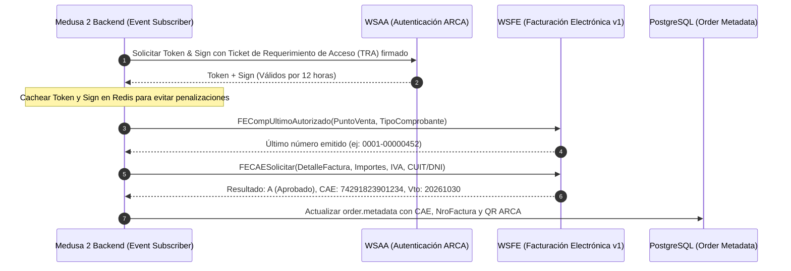

# Spike Técnico 03: Facturación Electrónica ARCA (ex-AFIP)

## 1. Contexto & Objetivos
El objetivo de este spike es diseñar la integración con los servicios web de **ARCA** (Agencia de Recaudación y Control Aduanero, ex-AFIP) en **Medusa 2.21.2**, permitiendo la emisión automática de **Factura A** (para compradores B2B Responsables Inscriptos) y **Factura B** (para compradores minoristas B2C y Monotributistas) al confirmarse un pago.

---

## 2. Arquitectura de Servicios Web ARCA (WSFE v1)



---

## 3. Tipos de Comprobantes Fiscales por Canal

| Canal | Tipo de Comprobante | Código ARCA | Requisitos del Comprador | Tratamiento de IVA |
|---|---|---|---|---|
| **Talabartería B2B** | **Factura A** | `001` | CUIT obligatorio + Responsable Inscripto | IVA discriminado (21% / 10.5%) |
| **Pampa Novus B2C** | **Factura B** | `006` | Consumidor Final (DNI o sin identificar si < tope legal) | IVA incluido (no discriminado) |
| **Talabartería B2B** | **Factura B** | `006` | CUIT de Monotributista o IVA Exento | IVA incluido |

---

## 4. Estructura del Código QR Obligatorio de ARCA

Conforme a la RG AFIP 4892/2020, toda factura electrónica debe incluir un código QR que apunta a la URL oficial de validación:

$$\text{URL} = \text{https://www.afip.gob.ar/fe/qr/?p=} + \text{Base64}(\text{JSON Payload})$$

### Formato del Payload JSON:
```json
{
  "ver": 1,
  "fecha": "2026-10-20",
  "cuit": 30582914725,
  "ptoVta": 1,
  "tipoCmp": 1,
  "nroCmp": 453,
  "importe": 387200,
  "moneda": "ARS",
  "ctz": 1,
  "tipoDocRec": 80,
  "nroDocRec": 30712345679,
  "tipoCodAut": "E",
  "codAut": 74291823901234
}
```

---

## 5. Implementación en Medusa 2: Event Subscriber (`order.placed`)

En Medusa 2, la emisión se desencadena de forma desacoplada y asíncrona mediante un suscriptor de eventos:

```typescript
import { SubscriberArgs, SubscriberConfig } from '@medusajs/framework'

export default async function invoiceOrderSubscriber({
  event: { data },
  container,
}: SubscriberArgs<{ id: string }>) {
  const orderService = container.resolve('order')
  const arcaService = container.resolve('arcaInvoiceService')

  const order = await orderService.retrieveOrder(data.id, {
    relations: ['items', 'shipping_address', 'customer'],
  })

  // Determinar si corresponde Factura A o Factura B
  const isB2B = order.sales_channel_id === 'sc_talabarteria_b2b'
  const cuit = order.shipping_address?.metadata?.cuit || order.customer?.metadata?.cuit

  let invoiceResult
  if (isB2B && cuit) {
    invoiceResult = await arcaService.emitirFacturaA(order, cuit)
  } else {
    invoiceResult = await arcaService.emitirFacturaB(order)
  }

  // Persistir metadatos fiscales inmutables
  await orderService.updateOrder(order.id, {
    metadata: {
      arca_cae: invoiceResult.cae,
      arca_cae_vto: invoiceResult.caeVto,
      arca_comprobante: invoiceResult.comprobanteNumero,
      arca_qr_url: invoiceResult.qrUrl,
      arca_estado: 'EMITIDA',
    },
  })
}

export const config: SubscriberConfig = {
  event: 'order.placed',
}
```

---

## 6. Homologación Segura
- **Entorno**: WSFE Homologación (`wswhomo.afip.gov.ar`).
- **Seguridad**: Certificados digitales `.crt` y `.key` nunca se versionan en Git; se inyectan en el VPS mediante secretos del sistema de archivos con permisos `chmod 600`.
- **Cero Cobros / Cero Impacto Fiscal Real**: En homologación, las autorizaciones de CAE son ficticias y no generan obligaciones tributarias.
